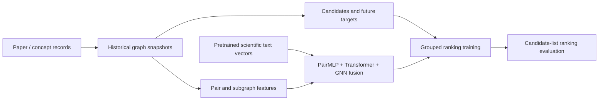

# Scientific Relation Learning with Temporal Graphs


**LBD research spanning scientific graph construction, semantic and structural features, neural ranking, and temporal evaluation.** The project adapts recommendation-inspired attention and local-subgraph learning to scientific papers and concepts, then explores a fusion model combining pair features, a subgraph Transformer and a GNN.

[English](README.md) · [简体中文](README.zh-CN.md)

## Research idea

Scientific relationships can be modeled as ranking problems: use historical graph structure and scientific text representations to score candidate relationships. The work progresses from paper citation retrieval to temporal concept ranking, with a separate FoS extension. Each task retains its own graph, labels, candidate universe and evaluation protocol. [Task definitions and graph construction](docs/graph_construction.md).

## Research pipeline



The v15 temporal implementation uses 21 pair features, 768-dimensional semantic vectors, structural neighborhood tensors and merged local graphs. The FoS extension adds fourteen topology features. [Feature dictionary](docs/features.md) · [Models and core mechanisms](docs/models.md).

## Quick start

Python 3.11+ and [uv](https://docs.astral.sh/uv/) are required. Run from this repository root:

```bash
uv sync --locked --extra train
uv run --locked --extra train python -m tests.test_research_contracts
uv run --locked --extra train python -m examples.synthetic_pipeline
uv run --locked --extra train python -m scripts.check_repository
```

The CPU example calls the retained graph/feature functions and v15 repair variant, performs forward/backward computation and optimizer updates, then computes ranking metrics. Its graph and 768-dimensional vectors are synthetic. No model weights, remote dataset or training server are needed. This is an executable pipeline check, not a scientific benchmark. [Observed output](examples/outputs/synthetic_pipeline.json) · [Validation](docs/results.md).

## Models and learning objectives

The implementation includes Phoenix-inspired paper scoring, PENCIL-style local-subgraph encoders, pairwise ranking on temporal graph-distance change, and a later three-branch fusion model with graded-relevance ranking. The retained repair variant aligns node identities, graph indices and prediction-rank-dependent NDCG weights. These are concrete model/data/training adaptations; pretrained encoders and upstream modeling ideas retain attribution. [Model details](docs/models.md).

## Data and features

Graph builders cover cumulative co-occurrence, first-co-occurrence interval graphs, PPR-labeled propagation signals and FoS snapshots. These graph variants are documented separately. Features include common neighbors, Adamic–Adar, degree/clustering statistics, neighborhood overlap, heuristic gravity features and scientific text vectors. The dictionary records exact column order and duplicate/approximate fields. [Graph construction](docs/graph_construction.md) · [Features](docs/features.md).

## Training and evaluation

Original scripts preserve grouped candidate sampling, AdamW, cosine scheduling, checkpointing, early stopping and multiple historical windows. Evaluation includes graded NDCG and binary Precision/Recall/MRR, plus a separate citation-retrieval baseline. The [training/evaluation protocol](docs/training_evaluation.md) specifies labels, denominators, sampling and split scope. [Run instructions](docs/reproducibility.md) include safe dry-run dispatch before full-data execution.

## Experimental record

The local archive retains preparation metadata and candidate indexes for five windows from 2005→2012 through 2021→2024. Historical README scores are kept as reported records with their verification status. Successful predictive gains have not been established by this showcase. Numerical checks and CPU optimization are reported separately from historical research results. [Results and evidence](docs/results.md).

## Repository map

```text
research/temporal/       Historical builders, v5/v15 training and evaluation
  fixes/                Previously retained v15 repair scripts
research/citation/      Citation data, encoders, Phoenix/PENCIL adaptations, retrieval
research/fos/           FoS construction, topology features and training
examples/               CPU synthetic graph-to-training-to-metrics demonstration
tests/                 Small numerical regression contracts
scripts/               Portable dispatch and repository QA
docs/                  Graphs, feature dictionary, models, protocols and evidence
provenance/            Source hashes, sanitized history and Git evidence
```

## Provenance and publication

Twenty-seven research Python files are preserved byte-for-byte. Presentation additions provide documentation, dependencies, examples, regression checks and a path-override dispatcher. Large data, checkpoints, connection credentials and automatic server-control scripts are excluded. Historical READMEs have connection details removed; their redactions are recorded in the manifest.

Upstream PENCIL and X/Phoenix source revisions are identified in [third-party notices](THIRD_PARTY_NOTICES.md). Individual authorship and the project's distribution license remain for maintainer confirmation. This is a local review repository with no publishing remote. [Source provenance](docs/provenance.md) · [Change summary](CHANGELOG.md).
