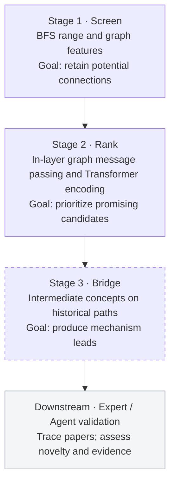

# Conjunction

**Exploring Temporal Link Prediction and Bridge Concepts in Scientific Knowledge Networks.**

**English** · [简体中文](README.zh-CN.md)

**Research question:** Can temporal graph structure help identify emerging links and bridge concepts in scientific knowledge networks? **Method:** Temporal graphs, 21 pair features, semantic and Transformer/GNN subgraph representations, graded distance ranking and path-based bridge analysis. **Key findings:** Candidate-index archives cover five windows from 2005 to 2024, with up to 1.83 million entries per window; research trials identify concept-label consistency as a central constraint.

The early citation model rewrites parts of the X/Twitter [Phoenix](https://github.com/xai-org/x-algorithm/tree/0bfc2795d308f90032544322747caacd535f75ae/phoenix) framework in PyTorch, adapting its input features and training objective to scientific citation completion. See [third-party notices](THIRD_PARTY_NOTICES.md) for the upstream source and license.

## 1. Motivation: Low-Hanging Fruit in Scientific Knowledge

### 1.1 Fish oil and Raynaud's syndrome: undiscovered public knowledge

The initial inspiration came from Don R. Swanson's 1986 paper, [*Fish Oil, Raynaud's Syndrome, and Undiscovered Public Knowledge*](https://pubmed.ncbi.nlm.nih.gov/3797213/). Raynaud's syndrome involves abnormal peripheral circulation: cold or emotional stress can restrict blood flow to the fingers and toes.

Swanson identified two relatively separate bodies of medical literature:

- Studies of fish oil reported effects on blood viscosity, platelet aggregation and vascular reactivity.
- Studies of Raynaud's syndrome connected these physiological factors with the condition's symptoms.

Bringing these findings together suggested a hypothesis worth testing: **Could fish oil alleviate Raynaud's syndrome?**


*A schematic of the literature reasoning in Swanson (1986). Solid lines represent reported connections; the dashed line represents the resulting hypothesis.*

What interested me was the way the hypothesis emerged. The relevant knowledge was already public; someone still had to connect it. Conventional literature searches begin with a known question, which assumes the researcher knows what to search for. When fields rarely interact, their published findings may remain disconnected even when they could inform one another.

This led me to ask whether we could start from the structure of scientific knowledge itself and actively look for potential connections, without requiring a researcher to formulate each question in advance.

### 1.2 Snowball Earth: connecting knowledge across disciplines

Another inspiration was Snowball Earth. Neoproterozoic strata contain features that were difficult to explain, including evidence of low-latitude glaciation and cap carbonates immediately above glacial deposits. Meanwhile, climate dynamics had established the possibility of an ice–albedo feedback: expanding ice reflects more sunlight, causes further cooling and could drive the planet into a globally frozen state.

Global freezing raised another question: how could Earth become warm again? In his [1992 Snowball Earth proposal](https://authors.library.caltech.edu/records/vaysf-cca32), Joseph Kirschvink connected the geological evidence with a possible escape mechanism. Global ice cover would strongly suppress chemical weathering that consumes atmospheric carbon dioxide, while volcanic outgassing could continue. Accumulating carbon dioxide could eventually produce enough greenhouse warming to end the frozen state.

This connected sedimentary geology, paleomagnetism, climate dynamics, greenhouse warming and the long-term carbon cycle. In his [2009 historical account](https://doi.org/10.1111/j.1365-2451.2009.00716.x), Paul Hoffman described a substantial gap between geologists studying Proterozoic glacial deposits and climate dynamicists studying extreme glaciation before the late 1980s. One community had geological evidence; the other had theoretical tools that could help explain it, but the connection was not widely recognized.

This history illustrates a possibility that interests me:

**Part of the answer to a persistent problem in one discipline may already exist in another, waiting to be connected.**

I think of these opportunities as the “low-hanging fruit” of scientific knowledge. They need not be new laws of nature. They could be a useful combination of existing findings, a new explanation for an old problem, or a lead worth testing.

### 1.3 From literature retrieval to active discovery

I wanted to explore a different starting point: analyze the structure of the literature, **identify relationships that have not yet been explicitly established but may be forming**, and then let researchers or AI scientist systems investigate and test them.

The intended output is a set of candidate scientific relationships with traceable literature sources for further investigation.

## 2. Core Design: Relational Structure and Temporal Evolution

### 2.1 Why not predict relationships directly from semantic embeddings?

This was an important design consideration from the beginning. Scientific names, classifications and descriptions already encode existing disciplinary organization: which field a concept belongs to, its place in a hierarchy and which definitions are close to it. I was concerned that relying mainly on semantic similarity could reproduce those existing classifications.

For cross-disciplinary discovery, this creates a tension:

**The concepts we want to connect may be far apart in current disciplinary taxonomies, yet related through scientific mechanisms.**

Similar names do not necessarily make a connection scientifically valuable. Conversely, concepts with very different meanings may be linked through a chain of mechanisms. A predominantly semantic model might find familiar relationships more easily than connections across established boundaries.

The project therefore focused on **how relationships form, as well as how concepts are described**. Semantic information still has a role: the code uses precomputed SciBERT vectors in selected models. In the original design, however, semantics was auxiliary; network topology and its evolution were the main research objects.

### 2.2 Temporal representation of scientific concept networks

The initial plan was to use OpenAlex papers, citations, publication dates and concept labels to construct scientific concept networks over time. Papers provide the main observations: when two concepts occur together in a qualifying paper, they can be connected by a co-occurrence edge. Citations supply relationships between papers and support some earlier research routes.

At a historical cutoff $t$, the observable concept graph is:

$$
G_t=(V,E_t)
$$

For concepts $u,v$ without a direct historical connection, the intended prediction is:

$$
P\big((u,v)\in E_{t+\Delta t}\mid G_{\leq t}\big)
$$

The original focus was on pairs with historical BFS distance greater than one: concepts linked indirectly, but not yet directly connected.

One intuition was to imagine concept communities as evolving galaxies. Whether two galaxies approach one another depends on their surroundings, interactions and motion, as well as their current distance. Similarly, future connections between concepts may depend on common neighbors, local communities, hubs and changes in their neighborhoods.

This heuristic analogy motivates a concrete question:

**Before two concepts become directly connected, are there recognizable changes in the network around them?**

### 2.3 Overall framework: screening, ranking and bridge explanation

The system is designed around three stages, followed by validation by human experts or a Co-Scientist-style LLM agent:



| Stage | Design objective | Current implementation |
|---|---|---|
| Screen | Reduce the search space with high recall | Distance, neighborhood and structural filters |
| Rank | Order candidates with high precision | In-layer graph message passing, Transformer encoding, PairMLP and a separate GNN branch with ranking training |
| Bridge | Provide bridging concepts for each pair | Shortest-path recovery and path-priority subgraph sampling |
| Downstream validation | Assess scientific value | Proposed handoff to experts or agents |

## 3. Feature Construction and Representation Learning

### 3.1 How are concept relationships represented?

The project explored several ways to describe a concept pair.

| Feature | Motivation |
|---|---|
| BFS distance | Current shortest topological distance |
| Bidirectional PPR-like propagation | Relative network position and reachability |
| Ego-graph and local adjacency | Preserve neighborhood nodes and direct edges for structural encoding and in-layer graph message passing |
| Common-neighbor count | Number of existing indirect connections |
| Common-neighbor degree distribution | Whether bridges are broad hubs or more specific concepts |
| Adamic–Adar | Downweight highly connected common neighbors |
| Clustering coefficient | Connectivity within a local neighborhood |
| Community membership (planned) | Whether concepts belong to the same knowledge community |
| Temporal neighborhood changes (planned) | Whether the two neighborhoods are gradually approaching one another |
| SciBERT | Semantic representations of concept text; the located encoding script uses concept names |

BFS, propagation quantities, common neighbors, Adamic–Adar, local subgraphs and some structural statistics are implemented across code versions. Community membership and continuous temporal change are planned extensions.

### 3.2 How do numerical features and graph structure enter the model?

Combining explicit numerical features with graph representations was already part of the earlier modeling approach. The PyTorch model separately encodes pair features, local neighborhoods and merged endpoint subgraphs, then fuses them into candidate ranking scores:

| Branch | Main input | Role |
|---|---|---|
| PairMLP | Explicit structural features of a concept pair | Learn structural relationships between a node pair |
| PENCIL-style Transformer | Local nodes, adjacency encoding and precomputed semantic representations | Interleave attention and graph message passing inside Transformer layers |
| SubgraphGNN | Two endpoints and their merged subgraph | Model graph connections around a candidate relationship |

The three representations are fused to produce candidate ranking scores. This organization explores whether pair features, individual neighborhoods and merged subgraphs provide complementary information. The retained implementations and attribution notes document their relationship to existing recommendation models, graph-learning methods and third-party code.

**The PENCIL branch itself contains graph computation.** Local nodes form the Transformer input, with representations combining local position, adjacency and semantic information. For example, the retained v15 configuration uses 129 structural fields per node: 64 local-position fields, 64 adjacency fields and one normalized propagation score. This is distinct from the 21 pair features used by PairMLP.

Each encoder layer performs attention, aggregates node states using local adjacency, applies a learned message transform and residual update, and then runs the feed-forward network. Four such layers precede pooling over valid nodes. Local edges therefore contribute both to input encoding and to representation updates inside the Transformer.

```text
Local structural and semantic node inputs
  → attention → local-edge aggregation and residual update → feed-forward network
  → repeat 4 layers → node pooling → PENCIL branch representation
```

Neighborhood construction varies by version. [Early v5](research/temporal/train_temporal_v5.py) selects a center concept and degree-ranked one-hop neighbors. [Later v15](research/temporal/train_temporal_v15.py) selects local nodes by PPR-like scores, then encodes their direct connections. Message passing uses one-hop edges within that selected graph. This in-layer module is separate from the parallel **SubgraphGNN**, which operates on the merged graph around both endpoints. See [Models](docs/models.md#graph-computation-inside-pencilencoder) for tensor layout and computation order.

### 3.3 Reducing generic hub effects

Two specialized concepts may both connect to a broad term such as “climate change,” yet that short path may offer little specific research context. A less connected intermediate concept may provide a more concrete literature lead. The project uses the following path costs and features:

- **Path costs:** $c(u,v)=\log((\deg(u)+\deg(v))/2+1)$ increases the cost of paths involving highly connected nodes.
- **Common-neighbor weighting:** Adamic–Adar reduces the contribution of highly connected intermediate nodes.
- **Low-degree features:** common-neighbor counts and Adamic–Adar are also calculated using only neighbors below the median degree of nonzero-degree nodes, to capture more specific bridging evidence.

[Feature-precomputation implementation](research/temporal/precompute_v15.py).

### 3.4 Bridge-concept prediction

Candidate ranking asks which concepts may connect. The bridge stage then asks what intermediate knowledge could connect them. The design takes internal nodes on shortest paths between $A$ and $B$ in the historical co-occurrence graph as candidate bridges. Weighted graphs use shortest paths under the specified edge cost. These intermediate concepts provide mechanism leads for each candidate relationship.

The following design example uses the connection between lightning and prebiotic phosphorus chemistry reported by [Hess et al. (2021)](https://www.nature.com/articles/s41467-021-21849-2) to illustrate the bridge output format:

```text
Candidate pair: (Phosphide, Lightning)
Candidate bridges: [early Earth, phosphorus reduction, prebiotic chemistry]
Interpretation: investigate lightning-driven phosphorus reduction and
                phosphide formation in early-Earth geochemistry and
                prebiotic chemistry.
```

Historical [`eval_3hop.py`](history/workspace/eval_3hop.py) recovers shortest paths within a hop limit and prioritizes their nodes during subgraph selection. Existing [`show_bridges.py`](history/server_snapshot/show_bridges.py) displays ranked endpoint concepts and distance labels.

### 3.5 Modeling intuition: a gravitational analogy for concept networks

The project draws on an intuition from celestial mechanics: concept nodes resemble celestial bodies, node degree corresponds to mass, BFS distance to spatial distance, and the PPR distribution to a gravitational field. Common neighbors and knowledge communities play the roles of intermediate bodies and star clusters. Connection strength within a community can be compared to binding energy, while a new cross-community relationship resembles overcoming an existing binding. As neighborhood overlap and bridging relationships increase, two concepts may move closer in the network and eventually co-occur for the first time. This analogy motivates the topological features and temporal modeling.

## 4. Implementation and Method Evolution

The retained code documents several changes in research tasks and models.

### 4.1 From paper citations to concept relationships

Early work adapted recommendation and link-prediction methods to scientific paper networks, using citations, semantic representations and candidate ranking to explore potential relationships. The focus then shifted to temporal concept co-occurrence graphs and prediction targets based on changes in historical graph distance. Local graph encoding, in-layer graph messages and multibranch fusion were already used in earlier versions. The v15 route retained this structure while changing candidate filtering, relevance labels and the ranking loss.

Main source locations:

- [Paper citations and early models](research/citation/)
- [Temporal concept graph construction](research/temporal/build_temporal_data.py)
- [Temporal feature precomputation](research/temporal/precompute_v15.py)
- [v15 models and training](research/temporal/train_temporal_v15.py)
- [Later repair versions](research/temporal/fixes/)

### 4.2 Training and historical experiments

The research tried classification, pairwise ranking, BPR, distance-change ranking and ranking losses with NDCG-based weights. Temporal experiments used multiple historical windows covering parts of 2005–2024. The repository retains candidate construction, training, evaluation and historical records. Different versions used different targets: later v15 experiments mainly learned relevance grades derived from future weighted distances. Section 5.3 describes the changes in task definition and candidate protocols.

[Models](docs/models.md) · [Training and evaluation protocol](docs/training_evaluation.md) · [Historical results](docs/results.md)

## 5. Progress and Reasons for Pausing

After several rounds of modeling and training, the project encountered problems that required attention before further model changes. Graph sparsity was the most immediate difficulty; concept-label quality and its implications for the task ultimately determined whether to continue investing time.

### 5.1 Sparse concept graphs and limited training signal

Restricting the discipline, concept level and historical window left many concepts with few useful connections. The original goal concerned pairs that were not directly connected but would later form cross-disciplinary relationships. Such positives were scarce relative to a large candidate space. This complicated both model training and the construction of meaningful candidates and supervision.

I tried several loss functions and ranking strategies without obtaining sufficiently strong, stable performance. These attempts led me to reconsider what information the training data could supply. With limited connections and target examples, adding model components could not replace checking the graph, candidates and labels themselves.

### 5.2 Label errors change what “not yet connected” means

The project used the legacy OpenAlex Concepts system. It provided large-scale paper classifications, but concept labels and paper assignments became a central concern during use and manual inspection. One suspected example involved `Lightning`: atmospheric lightning and Apple's Lightning connector may have been associated with labels carrying different meanings. This specific case still requires confirmation against the original concept IDs and paper records.

Such problems propagate through graph construction. Splitting one scientific concept across nodes, or merging different meanings of a word, can make graph connectivity diverge from the literature. A particularly difficult case is when **two concepts have already been connected in published work, but recognition or mapping errors make the graph show no prior connection**.

For first-connection prediction, this affects whether the labels are valid. A model that fits the graph may learn patterns caused by labeling errors rather than identify scientific connections that have not yet been made. Concept consistency therefore requires checks against the original papers and node mappings, beyond downstream modeling.

OpenAlex has since [deprecated Concepts in favor of Topics](https://help.openalex.org/data/concepts/). This gives a reason to reconsider the concept system, but ambiguity, missing labels and incorrect assignments in the actual data still require inspection. The cost of addressing these foundational problems was the main consideration behind pausing the project.

### 5.3 Implementation repairs and task definition are separate issues

The many iterations also introduced issues involving candidate indices, node alignment, subgraph padding and ranking calculations. The retained [`fixes/`](research/temporal/fixes/) versions address candidate grouping, endpoint preservation and conflicts between valid node IDs and padding values. These repairs make the data and model inputs more consistent.

Other problems concern the training task itself. Some later versions include historically connected nodes as candidates and filter candidates by future reachability. This differs from predicting first connections using historical information alone: existing edges enter the ranking set, and future information affects which objects can become candidates.

Implementation repairs do not automatically resolve these protocol differences. A new experiment would first need consistent historical graphs, candidate conditions and future labels. Existing distance-ranking results should be interpreted under their actual tasks, rather than treated as first-time scientific relationship prediction performance.

Path search and subgraph sampling are retained in the bridge module. Subsequent interface work includes organizing the internal path nodes into a standalone bridge-concept output.

### 5.4 Why pause the work?

Continuing would require revisiting the concept system, cleaning the data and fixing the task definition, followed by rebuilding graphs and retraining. These steps take more time than adding another model component, but more directly determine whether the results can be interpreted.

Given the repair and retraining cost, I decided to pause the project, preserve the code and experiment records from each stage, and focus on other research. The original question remains worth exploring. Restarting would first require a data foundation that can support it.

## 6. Future Directions

If I return to the project, I would start with data sources and concept consistency. One possibility is biomedical literature with a more standardized terminology system, such as MEDLINE's MeSH annotations, together with appropriate concept mapping.

This may offer better control over synonyms, ambiguity and concept hierarchies than directly using legacy OpenAlex Concepts.

I would then redefine the training task explicitly:

1. Freeze the concept set and existing connections at a historical cutoff.
2. Select only concept pairs without a direct connection at that time.
3. Construct structural, temporal and any necessary semantic features from historical information.
4. Use future publications to identify candidates that form their first direct connection.
5. Trace the underlying papers and intermediate knowledge, then have researchers or AI scientist systems assess the scientific significance.

The intended outcome is a small set of connections worth investigating, with traceable literature evidence.

## 7. Repository Layout and Running the Code

| Path | Contents |
|---|---|
| [`research/citation/`](research/citation/) | Paper-citation tasks and early models |
| [`research/temporal/`](research/temporal/) | Temporal graphs, features, ranking models and training |
| [`research/temporal/fixes/`](research/temporal/fixes/) | Later repairs |
| [`research/fos/`](research/fos/) | Related graph-learning extensions |
| [`history/`](history/) | Historical source and version index |
| [`docs/`](docs/) | Methods, data protocols, results and operation |
| [`examples/`](examples/) · [`tests/`](tests/) | Synthetic examples and numerical checks |

Requires Python 3.11+ and [uv](https://docs.astral.sh/uv/). Run from the repository root:

```bash
uv sync --locked --extra train
uv run --locked --extra train python -B -m examples.synthetic_pipeline
uv run --locked --extra train python -B -m scripts.check_repository
```

The synthetic example exercises graph construction, features, forward/backward passes and ranking metrics. Real-data reproduction additionally requires original papers, matching concept indices, graph matrices, semantic vectors and the appropriate environment. Large datasets and checkpoints are not fully distributed. See [Running and reproduction](docs/reproducibility.md).

## References

1. Swanson, D. R. (1986). [Fish Oil, Raynaud's Syndrome, and Undiscovered Public Knowledge](https://pubmed.ncbi.nlm.nih.gov/3797213/). *Perspectives in Biology and Medicine*.
2. Hoffman, P. F., et al. (1998). [A Neoproterozoic Snowball Earth](https://pubmed.ncbi.nlm.nih.gov/9721097/). *Science*.
3. Hoffman, P. F., & Schrag, D. P. (2000). [Snowball Earth](https://www.scientificamerican.com/article/snowball-earth/). *Scientific American*.
4. Hoffman, P. F. (2009). [Pan-glacial—a third state in the climate system](https://doi.org/10.1111/j.1365-2451.2009.00716.x). *Geology Today*.
5. [OpenAlex — Concepts (deprecated)](https://help.openalex.org/data/concepts/).
6. Kirschvink, J. L. (1992). [Late Proterozoic Low-Latitude Global Glaciation: the Snowball Earth](https://authors.library.caltech.edu/records/vaysf-cca32). In *The Proterozoic Biosphere: A Multidisciplinary Study*.
7. Hess, B. L., Piazolo, S., & Harvey, J. (2021). [Lightning strikes as a major facilitator of prebiotic phosphorus reduction on early Earth](https://www.nature.com/articles/s41467-021-21849-2). *Nature Communications*.

Configuration: [Environment variables](docs/security.md).
