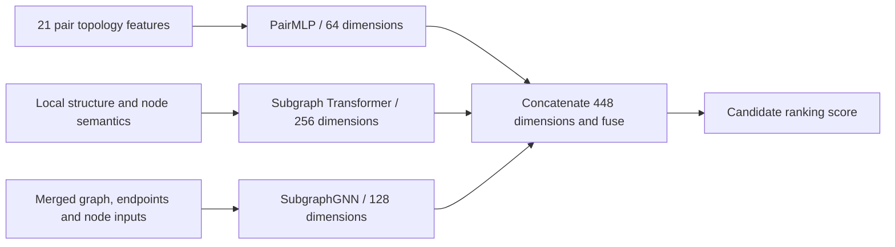

# Catalyst: Learning Emerging Scientific Relations from Temporal Graphs


**A research prototype that uses changes in scientific concept networks to study which currently indirect relationships may become explicit in later literature.** The project explores temporal co-occurrence graphs, hub effects, structural features, subgraph representations and candidate ranking for literature-based discovery (LBD), with the longer-term goal of producing scientific relation candidates that can be checked against papers.

**Status: research in progress.** The repository retains several graph, preprocessing, neural-model and training/evaluation implementations. Their task definitions and protocols still need consolidation, and some implementations have known problems. This README distinguishes the intended discovery task, the existing research routes and the work required to connect them. Catalyst is a working display name.

[English](README.md) · [简体中文](README.zh-CN.md)

## 🔬 1. Research question

Two scientific concepts can each have substantial literature while remaining unconnected in the same study. One LBD approach is to use indirect links in the existing knowledge network to identify combinations worth investigating. If a historical graph contains `A—B—C` but no `A—C`, a later paper studying A and C together creates a new direct relation.

This project investigates **structural signals before such relations become explicit**: neighborhood overlap, dependence on generic hubs, local connectivity and temporal proximity. Text representations describe how concepts are expressed; topology describes where they occur in a network and which other concepts connect them. Their individual value and complementarity are empirical questions under a common task.

“Topological collapse” is an intuitive description of an indirect path becoming a direct edge. Co-occurrence is an observable proxy, not automatic evidence of a scientific discovery or its mechanism. The intended output is a ranked set of relation candidates for subsequent examination of literature and scientific meaning.

## 🎯 2. Intended task and existing learning targets

The intended discovery task freezes candidates at a historical cutoff, excludes existing direct edges and predicts whether a new edge appears in a later window. For a cumulative co-occurrence graph `G_t=(V,E_t)`:

```text
Historical candidates: (u,v) ∉ E_t1
Future label: y(u,v) = 1 if (u,v) ∈ E_t2, otherwise 0
```

“First” is relative to the collected literature history. Candidate selection must not use future outcomes, and graph semantics, concept identity and time boundaries must remain consistent.

The code explores several related but distinct formulations:

| Route | Target in the code | Relationship to the intended task |
|---|---|---|
| Paper citation / indirect-citation retrieval | Rank a cited or two-hop target paper given a source and its references | Early adaptation of recommendation and link models to scientific documents |
| Concept-distance convergence | Rank historical pairs by `d_t1(u,v) − d_t2(u,v)` | Supervision for becoming closer, without requiring a future direct edge |
| v15 graded ranking | Convert future **weighted distance** into relevance grades 0–4 | Later main implementation; not a strict first-new-edge label |

A path shortening from four hops to two is convergence without direct connection. Likewise, a weighted-distance threshold is not a hop-count test. First association is therefore the research goal; convergence and graded ranking are existing exploratory learning routes. Their metrics are kept separate. [Task and graph definitions](docs/graph_construction.md).

## 🕸️ 3. Graph construction and hub handling

Original scripts read OpenAlex paper years and concept IDs, scores and levels; the main local sources concern geology and climate literature. Eligible concepts within one paper generate undirected co-occurrence relations. Level/score rules changed between versions, so identical-looking filenames do not establish identical graph semantics.

| Graph variant | Meaning | Usage boundary |
|---|---|---|
| Cumulative snapshot | All observed edges up to a cutoff | Historical knowledge state |
| First-co-occurrence interval graph | Edges first observed in the current cutoff interval | New relations; not a substitute for cumulative history |
| Weighted path graph | Edge costs followed by shortest-path computation | A proximity measure, distinct from the occurrence of an edge |

**Hub effects are a concrete part of the design.** A short path through a generic, highly connected concept can carry different information from a specific local connection. The traceable v15 `build_weighted_adj` uses:

```text
c(u,v) = log((degree(u) + degree(v)) / 2 + 1)
```

Dijkstra then computes path cost. This degree penalty makes hub-mediated paths more expensive. Feature construction separately includes Adamic–Adar and statistics restricted to lower-degree common neighbors. These are different structural mechanisms, without a demonstrated guarantee that all generic and useful bridging hubs are separated.

The source version for the reported PMI-weighted branch is still being reconciled. The expression above documents the identified implementation; it is not relabeled as probability-based PMI. The PPR-named propagation arrays also retain their actual recurrence rather than inheriting mathematical properties from a filename. [Graph/weight definitions](docs/graph_construction.md) · [Expanded version audit](docs/design_status.md).

## 🧩 4. Features: topology is central; SciBERT is one component

The project extends beyond encoding concept names and taking cosine similarity. Its implementations represent explicit pair topology, individual concept neighborhoods and merged pair subgraphs.

| Representation | Inputs | Intended information |
|---|---|---|
| Pair features | Bidirectional propagation scores, common neighbors, Jaccard, Adamic–Adar, degree and clustering | Proximity and neighborhood relationships |
| Additional structural features | Low-degree common neighbors/Adamic–Adar, cohesion, second-order overlap and connectivity/path-strength proxies | More specific local support for a relationship |
| Local concept structure | Up to 64 positions with 129-wide tensors: positional, adjacency and propagation fields | Structural patterns around a concept |
| Merged pair graph | Up to 256 nodes, edges and local endpoint indices | The local environment connecting both endpoints |
| Semantic input | Precomputed 768-dimensional SciBERT concept-name vectors in selected models | Textual descriptions of graph nodes |

Temporal v15 uses **15+6=21 pair features**. The separate FoS configuration adds fourteen topology fields, including core/Fiedler and neighbor-degree statistics, for a width of 35. Some columns are duplicated, and names such as `resistance_distance` denote heuristic proxies rather than exact effective resistance. [Exact feature expressions and order](docs/features.md).

SciBERT supplies fixed, precomputed node inputs in these models; it is neither the whole research method nor a foundation encoder trained here. Structural-only, semantic-only and combined comparisons remain needed to establish their respective contributions. This repository does not assert that semantics is ineffective or that every model is free of semantic inputs.

## 🧠 5. Model design and adaptation

The later v15 architecture combines three branches:



PairMLP learns combinations of explicit pair features. The PENCIL-style encoder combines Transformer attention with local message updates. SubgraphGNN performs three residual message-passing layers and reads both endpoints plus a graph mean. Fusion produces a scalar ranking score, not a calibrated probability of discovery. [Original model](research/temporal/train_temporal_v15.py) · [Retained repair](research/temporal/fixes/train_temporal_v15_fix.py).

The work adapts existing recommendation and graph-learning ideas to scientific tasks. Early Phoenix-style code maps source/history/candidate roles to papers and references. Later subgraph models change scientific node representations, candidate organization and ranking objectives. These are inspectable modeling and training adaptations; [upstream attribution](THIRD_PARTY_NOTICES.md) remains explicit.

Candidate selection and neural ranking express a division of work—reduce the search space, then distinguish candidates—but a unified experiment has not established the recall benefit of an integrated two-stage system. Historical display scripts print concept names, scores and distance-change labels. A dedicated bridge-concept prediction head with paper-grounded mechanism explanations is not a validated current output.

## 📐 6. Training and evaluation

The training unit is an anchor and its candidate list. Temporal v15 samples 100 candidates by default, with replacement for shorter lists. The trainer uses AdamW, cosine scheduling, checkpoints and early stopping on validation NDCG. Defaults are batch size 8, learning rate `3e-4`, up to 30 epochs and patience 5; these are script settings rather than established optimal values.

Early convergence models use pairwise ranking. v15 uses graded relevance; the retained repair weights RankNet softplus terms by NDCG changes computed from current predicted ranks. The original weighting depends on input positions. Both variants remain available, and local repair checks are not evidence of retrained full-data gains.

Five windows are represented: `2005→2012`, `2012→2015`, `2015→2017`, `2017→2021`, `2021→2024`. The v15 rolling entry trains on the first four and selects checkpoints on the fifth. That fifth window is validation in this procedure, not an independent untouched test set.

| Metric | Meaning in the retained implementation |
|---|---|
| NDCG@K | Ranking graded 0–4 relevance within the evaluated candidate list |
| Precision / Recall@K | Positives have grade ≥4; recall divides by positives in that sampled list |
| MRR | Reciprocal rank of the first positive in the list |
| Citation target-hit | A separate retrieval task: whether a particular indirect target is retrieved |

These values are not interchangeable with global novel-edge recall. The original temporal aggregator also handles no-positive lists differently across metrics. [Sampling, denominators and evaluation contracts](docs/training_evaluation.md).

## 🧪 7. Progress and unresolved research questions

Retained work includes multiple graph builders, distance/feature precomputation, neural architectures, ranking training and saved indexes for five windows. The `2021→2024` archive records 4,734 anchors and 1,831,632 candidate index entries. They establish actual preparation work, while original grouping/index inconsistencies prevent treating the archive as a verified complete training corpus.

The small CPU example runs original graph/feature functions, the retained fusion model, forward/backward computation, three optimizer updates and ranking metrics. Its 70-node graph and 768-dimensional vectors are synthetic. It validates an execution path, not predictive performance on scientific data. [Execution and historical evidence](docs/results.md).

| Open issue | Concrete observation | Consequence |
|---|---|---|
| Target/candidate mismatch | v15 includes historical direct neighbors and filters candidates using future reachability | Existing scores do not establish future-blind new-edge discovery |
| Distance/graph semantics | Weighted costs, hops and interval graphs differ; “first-hop-free” subtracts a constant one | Graph, label and positive definitions need to be frozen together |
| Implementation consistency | Retained fixes address grouping, endpoint retention, padding, node/feature alignment and ranking weights | Local repair checks do not re-establish all historical results |
| Predictive/explanation validation | No unified replayable real-data comparison, semantic/structure ablation or bridge-output evaluation | Isolated historical scores cannot support stable gains or mechanism discovery |

The research has explored substantive graph and learning designs and exposed a central problem: translating a scientific discovery objective into a consistent, leakage-controlled training task. The next experiment should freeze that task before adding model complexity. [Design/status audit](docs/design_status.md).

## ▶️ 8. Running the repository

Use Python 3.11+ and [uv](https://docs.astral.sh/uv/) from the repository root:

```bash
uv sync --locked --extra train
uv run --locked --extra train python -B -m tests.test_research_contracts
uv run --locked --extra train python -B -m examples.synthetic_pipeline
uv run --locked --extra train python -B -m scripts.check_repository
```

These are offline mechanism checks after dependency installation. Full research runs additionally require paper records, concept ordering, matching graph/propagation matrices, semantic inputs where used, and checkpoints. Full corpora and weights are not bundled. The path dispatcher defaults to showing a plan:

```bash
uv run --locked --extra train python -B -m scripts.run_research
uv run --locked --extra train python -B -m scripts.run_research --task precompute-v15-fix --data-root data/pencil_data -- --fold 0
```

Prepare a separate experiment directory, then add `--execute` as described in the [run guide](docs/reproducibility.md). Historical scripts can overwrite caches/checkpoints in the configured data root. Repaired precompute and training files must be used together.

```text
research/temporal/       Representative graph, temporal model and evaluation versions
  fixes/                Previously retained v15 implementation repairs
research/citation/      Paper tasks, encoders and recommendation/subgraph adaptations
research/fos/           FoS data adaptation and additional topology features
docs/                  Graphs, feature columns, models, protocols, results and status
examples/ / tests/      Synthetic pipeline and small numerical checks
provenance/            Source hashes and sanitized historical records
```

## 🧭 9. Next steps and provenance

First freeze a historical corpus and candidate universe, exclude existing direct edges and reserve future data for labels. With fixed identities, graph versions, candidate IDs, sampling and temporal windows, compare structural baselines, explicit-feature models, subgraph models and semantic fusion, reserving a separate test window. The PMI branch still needs source-version reconciliation. Bridge paths and paper-grounded explanations should be evaluated as a distinct output.

Twenty-seven research Python files retain their source hashes. They document task design, model adaptation, data processing and experimentation; the original research code remains unchanged. The GitHub repository is private while documentation and versions are being consolidated. [Source provenance](docs/provenance.md) · [Third-party notices](THIRD_PARTY_NOTICES.md). A distribution license has not been selected for the local research; the supplied reference draft's MIT line is not adopted automatically.
