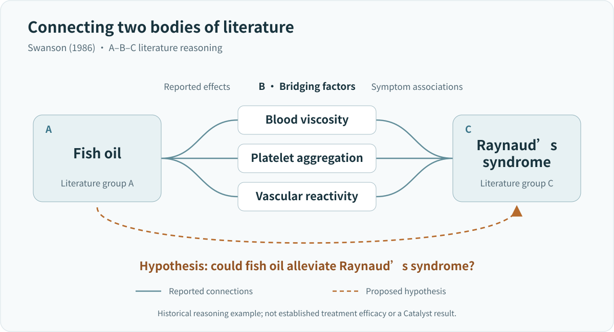
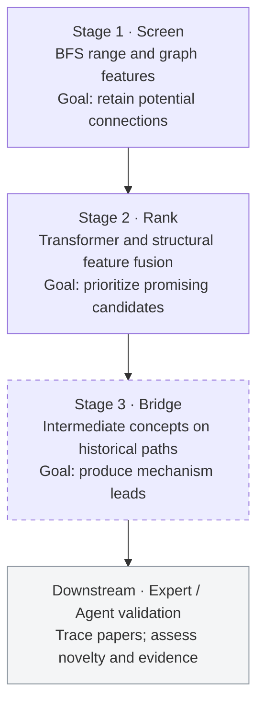

# Catalyst: Finding Connections in Scientific Knowledge Networks

**Literature-Based Discovery · Temporal Knowledge Graphs · Scientific Hypothesis Generation**

**English** · [简体中文](README.zh-CN.md)

Catalyst explores literature-based discovery (LBD) through temporal scientific concept networks. The design aims to identify indirectly connected concepts from historical graph structure and combine candidate ranking with bridge explanation to support literature investigation and hypothesis validation.

**Status: research prototype; currently paused.** The repository preserves graph construction, structural features, neural ranking, training/evaluation and historical path-processing code. The complete discovery workflow has not been validated.

## 1. Motivation: Low-Hanging Fruit in Scientific Knowledge

### 1.1 Fish oil and Raynaud's syndrome: undiscovered public knowledge

[Swanson (1986)](https://pubmed.ncbi.nlm.nih.gov/3797213/) connected two relatively separate bodies of medical literature. Fish-oil studies reported effects on blood viscosity, platelet aggregation and vascular reactivity; Raynaud's studies associated these factors with impaired peripheral circulation. Together, they suggested a testable hypothesis: **Could fish oil alleviate Raynaud's syndrome?**



*A schematic of Swanson's (1986) literature reasoning, not a Catalyst result.*

The example locates discovery opportunities in gaps between published findings. Conventional retrieval begins with a question; LBD uses indirect relationships to generate leads for investigation.

### 1.2 Snowball Earth: interdisciplinary knowledge integration

Snowball Earth offers another example of interdisciplinary integration. Low-latitude glacial deposits and cap carbonates supply geological evidence; ice–albedo feedback explains the possibility of global freezing; reduced weathering and continued volcanic CO₂ accumulation provide an escape mechanism. [Kirschvink (1992)](https://authors.library.caltech.edu/records/vaysf-cca32) connected these questions, while [Hoffman (2009)](https://doi.org/10.1111/j.1365-2451.2009.00716.x) described the earlier communication gap between geology and climate dynamics.

The motivating idea is that **a problem in one discipline may require connecting evidence or methods already available in another**.

### 1.3 From literature retrieval to active discovery

The project aims to identify candidate concept pairs and bridging knowledge with traceable paper sources, for researchers or AI scientist systems to assess their scientific significance.

## 2. Core Design: Temporal Structure and Scientific Relationship Prediction

### 2.1 Roles of structural and semantic information

Concept names and classifications often reflect established disciplinary boundaries. Cross-disciplinary relationships can have low textual similarity while sharing neighbors or indirect paths. The project therefore focuses on **relational structure and its evolution**, with SciBERT as an auxiliary input in selected models. The predictive contributions of structure and semantics require ablations under a common task definition.

### 2.2 Temporal scientific concept networks

Temporal co-occurrence graphs are constructed from OpenAlex papers, publication dates and concept labels. Concepts are nodes; qualifying co-occurrence within a paper creates an undirected edge. Paper citations support earlier research branches. Given the observable historical graph $G_t=(V,E_t)$, the original objective concerns indirectly connected pairs without a direct edge:

$$
P\big((u,v)\in E_{t+\Delta t}\mid G_{\leq t}\big),\qquad (u,v)\notin E_t
$$

The question is whether common neighbors, local subgraphs, hubs and neighborhood changes contain structural signals preceding a new connection.

### 2.3 Overall framework: screening, ranking and bridge explanation

The system is designed around three stages, followed by validation by human experts or a Co-Scientist-style LLM agent:



| Stage | Design objective | Current implementation |
|---|---|---|
| Screen | Reduce the search space with high recall | Distance, neighborhood and structural filters exist; protocols vary by version |
| Rank | Order candidates with high precision | Transformer, PairMLP and GNN fusion with ranking training |
| Bridge | Provide bridging concepts for each pair | Path recovery and path-priority subgraph construction exist; standalone bridge output is incomplete |
| Downstream validation | Assess scientific value | Proposed handoff to experts or agents |

High recall and high precision describe the intended division of work. A unified evaluation of the three-stage pipeline remains outstanding.

## 3. Features and Research Ideas

### 3.1 Multiscale relationship representations

| Feature | Role |
|---|---|
| BFS distance | Topological distance and candidate range |
| Bidirectional PPR-like propagation | Relative network position and reachability |
| Ego-graph | Local neighborhood structure |
| Common neighbors and their degrees | Number and specificity of indirect connections |
| Adamic–Adar | Downweight highly connected common neighbors |
| Clustering coefficient | Within-neighborhood connectivity |
| SciBERT | Concept-text encoding; the located script uses concept names |
| Community membership and continuous temporal neighborhood change | Design directions without a unified, validated implementation |

Features appear across different historical versions. Later v15 models use 21 explicit structural features together with local subgraphs and semantic inputs; see the [feature dictionary](docs/features.md).

### 3.2 Reducing generic hub effects

Broadly connected concepts can create many short paths with limited scientific specificity. Three implemented designs address this issue:

- **Path costs:** $c(u,v)=\log((\deg(u)+\deg(v))/2+1)$ increases the cost of paths involving highly connected nodes.
- **Common-neighbor weighting:** Adamic–Adar reduces the contribution of highly connected intermediate nodes.
- **Low-degree features:** common-neighbor counts and Adamic–Adar are also calculated using only neighbors below the median degree of nonzero-degree nodes, to capture more specific bridging evidence.

These designs have [code implementations](research/temporal/precompute_v15.py); their predictive benefit requires controlled comparisons.

### 3.3 Bridge-concept prediction

The bridge stage asks **which concepts may connect, and which intermediate concepts could explain the relationship**. The design takes internal nodes on shortest paths between $A$ and $B$ in the historical co-occurrence graph as candidate bridges. Weighted graphs use shortest paths under the specified edge cost. These nodes provide mechanism leads; scientific mechanisms require supporting evidence from the original papers.

Illustrative output format:

```text
Candidate pair: (Phosphide, Lightning)
Candidate bridges: [early Earth, phosphorus reduction, prebiotic chemistry]
Interpretation: investigate lightning-driven phosphorus reduction and
                phosphide formation in early-Earth geochemistry and
                prebiotic chemistry.
```

This illustrates the intended output, not a saved prediction or recovered shortest path. The scientific connection is reported by [Hess et al. (2021)](https://www.nature.com/articles/s41467-021-21849-2); first co-occurrence requires verification against a specific historical cutoff.

Historical [`eval_3hop.py`](history/workspace/eval_3hop.py) recovers shortest paths within a hop limit and prioritizes their nodes during subgraph selection. Existing [`show_bridges.py`](history/server_snapshot/show_bridges.py) displays ranked endpoint concepts and distance labels. Organizing intermediate path nodes into a standalone bridge output remains unfinished.

## 4. Implementation and Method Evolution

### 4.1 From paper citations to concept relationships

The research moved from paper-citation retrieval and recommendation-model adaptation to temporal concept graphs, distance-change supervision and local-subgraph fusion:

| Code | Contents |
|---|---|
| [`research/citation/`](research/citation/) | Citation networks and early recommendation/link-model adaptation |
| [`build_temporal_data.py`](research/temporal/build_temporal_data.py) | Temporal concept graphs and distance-change tasks |
| [`precompute_v15.py`](research/temporal/precompute_v15.py) | Candidate, structural-feature and subgraph precomputation |
| [`train_temporal_v15.py`](research/temporal/train_temporal_v15.py) | Fusion model, training and evaluation |
| [`fixes/`](research/temporal/fixes/) | Retained later repairs |

### 4.2 Neural models

The later v15 PyTorch model fuses three representation branches to produce candidate ranking scores:

| Branch | Input and role |
|---|---|
| PairMLP | 21 explicit graph features encoding pair structure |
| PENCIL-style Transformer | Local subgraphs and precomputed semantics encoding neighborhoods and candidate context |
| SubgraphGNN | Two endpoints and their merged subgraph encoding surrounding connectivity |

This implementation explores multiscale representations and task adaptation. Existing methods and third-party code are attributed in [Provenance](docs/provenance.md) and [Third-party Notices](THIRD_PARTY_NOTICES.md).

### 4.3 Training and historical experiments

Historical experiments cover selected windows within 2005–2024 and explore classification, pairwise ranking, BPR, distance-change ranking and NDCG-weighted losses. The available records do not establish stable scientific discovery performance.

Targets differ across versions: later v15 learns relevance grades from future weighted distances, which differs from the original first-new-connection objective. See [Models](docs/models.md), [Training and evaluation](docs/training_evaluation.md) and [Results](docs/results.md) for model details, candidate protocols and historical records.

## 5. Project Status and Main Limitations

### 5.1 Graph sparsity and limited training signal

Restricting the discipline, concept level and historical window leaves few useful connections and few positive first-time cross-disciplinary links relative to the candidate space. Loss and ranking variants did not produce stable performance; greater model complexity did not resolve the limited training signal.

### 5.2 Concept-label noise and identity consistency

Concept-label quality was the main reason for pausing. Ambiguity, synonym splitting and incorrect paper labels can produce apparent missing edges where literature connections already exist, invalidating first-connection labels. Manual inspection encountered a suspected `Lightning` ambiguity involving atmospheric lightning and a device connector; the specific concept IDs and papers still require confirmation. OpenAlex has [deprecated Concepts in favor of Topics](https://help.openalex.org/data/concepts/); concept consistency still requires separate checks.

### 5.3 Implementation and evaluation protocols

Later repairs address candidate indices, node alignment, endpoint preservation, padding and ranking calculations. Some versions still include existing edges as candidates and filter by future reachability, so they do not follow a strict historical first-new-connection protocol.

### 5.4 Research priorities and the decision to pause

Further work first requires repairing the concept system, data and task definition. Given the cleaning and retraining cost, the project is paused with code and experiment records preserved for future research.

## 6. Future Research Directions

Restarting would prioritize biomedical literature and terminology resources such as MEDLINE/MeSH, improve concept mapping and fix the following protocol:

1. Freeze historical concepts, node identities and existing connections.
2. Select pairs without historical direct edges and construct features from historical information only.
3. Label first direct connections in future publications and evaluate screening and ranking separately.
4. Output bridge concepts and paper evidence for expert or agent assessment of novelty and scientific significance.

## 7. Repository Layout and Running the Code

| Path | Contents |
|---|---|
| [`research/citation/`](research/citation/) | Paper-citation tasks and early models |
| [`research/temporal/`](research/temporal/) | Temporal graphs, features, ranking models and training |
| [`research/temporal/fixes/`](research/temporal/fixes/) | Later repairs |
| [`research/fos/`](research/fos/) | Related graph-learning extensions |
| [`history/`](history/) | Historical source and version index |
| [`docs/`](docs/) | Methods, data protocols, results and operation |
| [`examples/`](examples/) · [`tests/`](tests/) | Synthetic examples and numerical checks |

Requires Python 3.11+ and [uv](https://docs.astral.sh/uv/). Run from the repository root:

```bash
uv sync --locked --extra train
uv run --locked --extra train python -B -m examples.synthetic_pipeline
uv run --locked --extra train python -B -m scripts.check_repository
```

The synthetic example exercises graph construction, features, forward/backward passes and ranking metrics. Real-data reproduction additionally requires original papers, matching concept indices, graph matrices, semantic vectors and the appropriate environment. Large datasets and checkpoints are not fully distributed. See [Running and reproduction](docs/reproducibility.md).

## References

1. Swanson, D. R. (1986). [Fish Oil, Raynaud's Syndrome, and Undiscovered Public Knowledge](https://pubmed.ncbi.nlm.nih.gov/3797213/). *Perspectives in Biology and Medicine*.
2. Hoffman, P. F., et al. (1998). [A Neoproterozoic Snowball Earth](https://pubmed.ncbi.nlm.nih.gov/9721097/). *Science*.
3. Hoffman, P. F., & Schrag, D. P. (2000). [Snowball Earth](https://www.scientificamerican.com/article/snowball-earth/). *Scientific American*.
4. Hoffman, P. F. (2009). [Pan-glacial—a third state in the climate system](https://doi.org/10.1111/j.1365-2451.2009.00716.x). *Geology Today*.
5. [OpenAlex — Concepts (deprecated)](https://help.openalex.org/data/concepts/).
6. Kirschvink, J. L. (1992). [Late Proterozoic Low-Latitude Global Glaciation: the Snowball Earth](https://authors.library.caltech.edu/records/vaysf-cca32). In *The Proterozoic Biosphere: A Multidisciplinary Study*.
7. Hess, B. L., Piazolo, S., & Harvey, J. (2021). [Lightning strikes as a major facilitator of prebiotic phosphorus reduction on early Earth](https://www.nature.com/articles/s41467-021-21849-2). *Nature Communications*.
