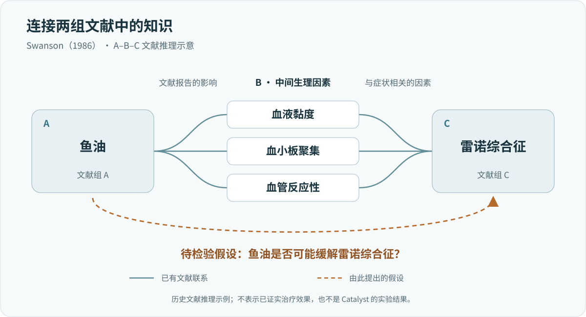
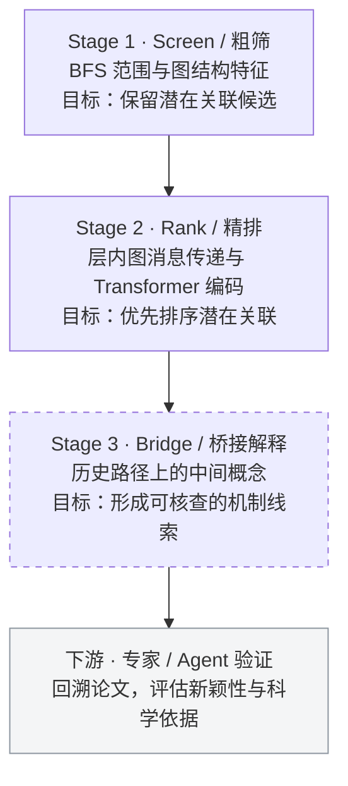

# Catalyst：从科学知识网络中寻找尚未建立的联系

**Literature-Based Discovery · Temporal Knowledge Graphs · Scientific Hypothesis Generation**

[English](README.md) · **简体中文**

> 利用科学概念网络的历史演化，寻找已有知识之间尚未明确建立、但值得进一步研究的联系。

这个项目从一个问题出发：**科学文献中是否存在大量尚未被充分连接的知识？能否利用网络结构与历史演化，提前找到其中一些值得研究的关联？**

围绕这一问题，项目开展了文献网络构建、图特征计算、神经排序和训练评估等尝试，并将桥接概念解释纳入整体设计。**当前状态为暂停中的研究原型**：代码与实验记录已保留，尚未形成可靠的端到端科学发现结果。

## 1. 研究动机：科学知识中的低垂果实

### 1.1 鱼油与雷诺综合征：尚未被发现的公共知识

这个项目最初受到 Don R. Swanson 于1986年发表的论文 [*Fish Oil, Raynaud's Syndrome, and Undiscovered Public Knowledge*](https://pubmed.ncbi.nlm.nih.gov/3797213/) 启发。雷诺综合征是一种涉及末梢血液循环异常的疾病，患者可能因寒冷或情绪刺激出现手指、脚趾血流受限。Swanson 注意到，当时存在两组相对独立的医学文献：

- 一组研究鱼油，报告了其对血液黏度、血小板聚集和血管反应性的影响。
- 另一组研究雷诺综合征，发现这些生理因素与疾病症状之间存在联系。

如果把两组知识放在一起，就可能得到一个值得进一步检验的假设：**鱼油是否可能缓解雷诺综合征？**



*Swanson（1986）的文献推理示意。实线为已有文献联系，虚线为待检验假设。*

这个例子吸引我的地方，是相关知识在假设提出之前就已经公开，缺少的是将它们联系起来的过程。

传统文献检索通常从已知问题出发，寻找相关证据。但研究者首先需要知道应该搜索什么。如果两个研究领域长期缺乏交流，即使相关论文都已公开，也未必有人意识到它们可以组合起来。这让我开始思考：如果不依赖研究者事先提出明确的问题，而是从整个科学知识网络出发，是否能够主动找到类似的潜在联系？

### 1.2 雪球地球：不同学科之间的知识连接

另一个启发来自雪球地球（Snowball Earth）。新元古代地层中存在一些长期难以解释的地质现象，例如低纬度冰川沉积证据，以及冰川沉积结束后紧接着出现的盖帽碳酸盐岩。与此同时，气候动力学研究已经揭示了冰—反照率正反馈的可能性：冰雪覆盖增加会使地球反射更多太阳辐射，导致进一步降温，极端情况下可能进入全球冻结状态。然而，全球冻结又产生新的困难：如果地球被冰雪覆盖，为什么后来还能够重新变暖？

在[1992年的雪球地球构想](https://authors.library.caltech.edu/records/vaysf-cca32)中，Joseph Kirschvink 将这些地质证据与一种脱离全球冰冻的机制联系起来：全球冰冻会强烈抑制消耗大气二氧化碳的化学风化过程，但火山活动仍然能够持续向大气释放二氧化碳。经过漫长积累，温室效应可能最终使地球脱离冰冻状态。这一思路进一步将地质沉积、古地磁、气候动力学、大气温室效应和长期碳循环联系起来。

Paul Hoffman 在[2009年的回顾](https://doi.org/10.1111/j.1365-2451.2009.00716.x)中指出，在20世纪80年代末以前，研究元古代冰川沉积的地质学家与研究极端冰冻状态的气候动力学家之间，存在明显的信息隔阂：一方掌握了地质证据，另一方拥有能够解释这些现象的理论工具，却没有充分认识到彼此成果之间的联系。这段研究史体现了我特别感兴趣的现象：

**一个学科长期困扰的问题，其答案的一部分可能已经存在于另一个学科中，只是尚未被充分联系起来。**

我把这些潜在机会理解为科学知识中的“低垂果实”。它们不一定是全新的自然规律，也可能是现有知识的重新组合、一个旧问题的重新解释，或者一条值得进一步检验的研究线索。

### 1.3 从文献检索转向主动发现

我希望探索一种不同的研究入口：先分析文献之间的知识结构，**识别尚未被明确建立、但可能正在形成的关联**，再交由研究者或 AI 科学家系统继续推理和验证。预期输出是一组有明确来源、能够回溯文献、值得进一步调查的候选科学关系。

## 2. 核心设计：关系结构与时序演化

### 2.1 为什么不直接使用语义向量预测关联？

这是项目最初一个重要的设计判断。科学概念的命名、分类及其文字描述，往往已经包含既有学科的知识组织方式。例如，不同专业术语通常存在某种层级关系：一个概念属于哪个学科、哪个分支、与哪些概念在定义上接近。这些信息本身已经反映了当前的知识分类体系。因此，我担心直接依赖语义相似度，会在一定程度上重复这种分类体系的判断。尤其对于跨学科知识发现，这可能存在一个矛盾：

**我们希望找到的恰恰是那些在现有学科分类中相距较远、但在科学机制上可能存在联系的概念。**

两个概念的名称非常相似，不代表它们的结合具有很高的研究价值；反过来，两个语义相距很远的概念，也可能通过一系列间接机制产生重要联系。如果模型主要依据语义预测，可能更擅长找到那些已经符合现有知识分类习惯的关联，却不一定擅长寻找跨越既有分类边界的联系。所以，项目从一开始就希望把重点放在**关系如何形成，而不只是概念如何被描述**。

实际代码也引入了 SciBERT 预训练向量，为节点提供语义信息。在原始设计中，语义作为辅助输入，网络拓扑及其时序演化是主要研究对象。两类信息各自的预测贡献，需要在相同任务和候选集合上检验。

### 2.2 科学概念网络的时序表示

最初的设想是利用 OpenAlex 的论文、引文关系、发表时间和概念标签，抽象出随时间演化的科学概念网络。其中，以论文为主要载体：如果两个概念共同出现在符合条件的论文中，就可以建立概念之间的共现关系。引文网络则提供论文之间的关系背景，并用于部分早期研究路径。在历史时点 $t$，构建当时可观察到的概念关系图：

$$
G_t=(V,E_t)
$$

对于两个尚未存在直接连接的概念 $u,v$，希望根据历史网络判断：

$$
P\big((u,v)\in E_{t+\Delta t}\mid G_{\leq t}\big)
$$

这里最初关注的是历史 BFS 距离大于1的概念对，尤其是已经存在间接路径、却还没有直接关系的概念。一种帮助我理解这个过程的直觉，是把不同概念群体想象成正在演化的星系。两个星系是否接近，不只取决于它们当前的距离，还与周围的结构、相互作用和运动状态有关。类似地，两个概念未来能否形成联系，也可能受到共同邻居、局部社区、枢纽节点以及邻域变化趋势的共同影响。这一启发式类比引出了一个具体问题：

**两个概念在尚未直接连接之前，它们周围的网络结构是否已经出现某些可以识别的变化？**

### 2.3 总体框架：粗筛、精排与桥接解释

系统按三个阶段设计，下游验证由人类专家或 Co-Scientist 式 LLM Agent 承担：



| 阶段 | 设计目标 | 当前实现 |
|---|---|---|
| Screen | 以高召回为目标缩小候选空间 | 已有距离范围、邻域与结构特征筛选，版本间协议不同 |
| Rank | 以高精度为目标细排候选 | 已有 Transformer 层内图消息传递、PairMLP 与独立 GNN 分支融合及排序训练 |
| Bridge | 为候选关系提供桥接概念 | 已有路径恢复与路径优先子图构建；独立桥接输出尚未完成 |
| 下游验证 | 判断关联是否具有科学价值 | 接口设想，由专家或 Agent 继续核查 |

高召回与高精度是阶段分工的设计目标。现有代码尚未形成经过统一评测的三阶段流水线。

## 3. 特征构造与表示学习

### 3.1 从哪些角度描述概念关系？

项目尝试从不同角度描述两个概念之间的关系。

| 特征 | 设计动机 |
|---|---|
| BFS 距离 | 当前关系的最短拓扑距离 |
| 双向 PPR 类传播量 | 两个概念在全局网络中的相对位置与可达性 |
| Ego-graph 与局部邻接 | 保留邻域节点及直接连边，用于结构编码和层内图消息传递 |
| 共同邻居数量 | 两个概念已有多少间接连接 |
| 共同邻居的度分布 | 桥接它们的是广泛连接的枢纽概念，还是较具体的概念 |
| Adamic–Adar | 降低高连接度共同邻居的权重 |
| 聚类系数 | 局部邻域内部的连接紧密程度 |
| 社区归属（设想） | 判断概念是否位于同一知识社区 |
| 共同邻域的时序变化（设想） | 观察两组概念的局部关系是否正在逐渐接近 |
| SciBERT | 提供概念文本的语义表示；已定位的编码脚本使用概念名称 |

其中，BFS、传播量、共同邻居、Adamic–Adar、局部子图以及部分结构统计已经体现在不同版本的代码中。社区归属和连续时序变化属于设计中考虑的方向，并未形成统一、经过验证的完整实现。

### 3.2 数值特征与图结构如何进入模型？

显式数值特征与图表示的结合，是项目较早就采用的建模思路。PyTorch 模型将概念对特征、局部邻域和两端点的合并子图分别编码，再融合为候选排序分数：

| 分支 | 主要输入 | 功能 |
|---|---|---|
| PairMLP | 概念对的显式图结构特征 | 学习节点对之间的结构关系 |
| PENCIL 风格的 Transformer | 局部节点、邻接编码与预计算语义表示 | 在 Transformer 层内交替执行注意力与图消息传递 |
| SubgraphGNN | 两个端点及其合并子图 | 建模候选关系周围的图连接 |

三个分支的表示进一步融合，输出候选关系的排序分数。这样的组织方式用于探索概念对特征、单节点邻域与合并子图能否提供互补信息。相关实现保留了原始研究路径，也注明了对既有推荐模型、图学习方法和第三方代码的借鉴。

**PENCIL 分支内部也包含图计算。** 每个概念的局部节点被组织为 Transformer 输入，节点表示同时编码局部位置、邻接关系和语义信息。以保留的 v15 配置为例，单节点结构输入为 129 维：64 维局部位置编码、64 维邻接编码和 1 维归一化传播分数；它与 PairMLP 使用的 21 维概念对特征是两种不同输入。

在每个编码层中，模型先执行注意力计算，再按局部邻接关系聚合节点状态，经过可学习的消息变换和残差更新后进入前馈网络。这一过程重复四层，再对有效节点池化。因此，局部连边既参与输入编码，也直接参与 Transformer 内部的表示更新。

```text
局部节点的结构与语义输入
  → 注意力更新 → 沿局部连边聚合并残差更新 → 前馈网络
  → 重复 4 层 → 节点池化 → PENCIL 分支表示
```

邻域的构造在版本间有所变化：[早期 v5](research/temporal/train_temporal_v5.py)选择中心概念及按度数筛选的一跳邻居；[后期 v15](research/temporal/train_temporal_v15.py)按 PPR 类分数选择局部节点，再写入这些节点之间的直接连边。消息传递使用的仍是所选局部图中的一跳连接。这个层内模块与独立的 **SubgraphGNN** 分支并列保留，后者在两个端点的合并子图上进行消息传递与读出。具体张量与计算顺序见[模型说明](docs/models.md#graph-computation-inside-pencilencoder)。

### 3.3 抑制泛化 hub 的影响

两个专业概念可能都与“气候变化”这样的宽泛概念相连，但这条短路径未必提供足够具体的研究线索。相比之下，通过连接范围较小的中间概念建立的关系，可能更容易对应到可调查的文献背景。项目据此尝试减少泛化 hub 对路径和特征的影响：

- **路径代价**：使用 $c(u,v)=\log((\deg(u)+\deg(v))/2+1)$，提高经过高连接度节点的路径成本。
- **共同邻居降权**：使用 Adamic–Adar，降低高连接度中间节点对关联分数的贡献。
- **低度邻居特征**：对度数低于非零节点度数中位数的共同邻居，单独计算数量与 Adamic–Adar，补充更具体的桥接证据。

以上设计已有[代码实现](research/temporal/precompute_v15.py)，效果增益尚待对照实验验证。

### 3.4 桥接概念预测

候选排序回答“哪些概念可能建立联系”，桥接阶段进一步追问“它们可能通过什么知识建立联系”。设计中，将历史共现图上连接 $A$、$B$ 的最短路径内部节点作为候选桥接概念；加权图中使用给定代价下的最短路径。它们提供待核查的机制线索，科学机制的成立仍需原文证据支持。

预期输出形式示例：

```text
候选概念对：(Phosphide, Lightning)
候选桥接概念：[early Earth, phosphorus reduction, prebiotic chemistry]
解释方向：在早期地球地球化学与前生命化学语境下，
          核查闪电驱动的磷还原与磷化物形成之间的联系。
```

该例展示桥接解释的输出形式，非已保存的模型预测或最短路径。相关科学联系已有[Hess 等（2021）](https://www.nature.com/articles/s41467-021-21849-2)报道；“首次共现”需相对于具体历史截点另行核验。

历史 [`eval_3hop.py`](history/workspace/eval_3hop.py) 已实现有限跳数内的最短路径恢复，并在子图采样中优先保留路径节点；现有 [`show_bridges.py`](history/server_snapshot/show_bridges.py) 展示的是排序概念对及距离标签。将路径中间节点组织为独立桥接输出，是尚待补齐的环节。

### 3.5 建模直觉：概念网络的引力类比

本项目借鉴天体力学的直觉，将概念节点类比为天体、节点度类比为质量、BFS 距离类比为空间距离、PPR 分布类比为引力场，而共同邻居和知识社区分别对应中间天体与星团。社区内部的连接强度可类比为束缚能，跨社区形成新关联则类似于突破原有束缚；随着邻域重叠和桥接关系增加，两个概念可能逐渐接近并最终形成首次共现。上述类比旨在解释拓扑特征与时序演化的建模动机，而非假定概念网络遵循真实的引力动力学。

## 4. 代码实现与方法演化

项目经历过多轮任务与模型调整，以下代码保留了这一演化过程。

### 4.1 从论文引用到概念关系

早期工作尝试将推荐模型和链接预测方法迁移到科学论文网络，使用论文引用、语义表示和候选排序来识别潜在关系。随后，研究重点逐渐转向时间演化的概念共现网络，并尝试使用历史图距离变化构造预测目标。局部图编码、层内图消息传递与多路表示融合已在较早版本中使用；v15 延续了这一结构，主要调整候选筛选、相关性标签和排序损失。主要代码包括：

- [论文引用与早期模型](research/citation/)
- [时序概念图构建](research/temporal/build_temporal_data.py)
- [时序特征预计算](research/temporal/precompute_v15.py)
- [v15 模型与训练](research/temporal/train_temporal_v15.py)
- [后续修复版本](research/temporal/fixes/)

### 4.2 训练与历史实验

研究中尝试过不同的监督与排序方法，包括分类、成对排序、BPR、基于距离变化的排序，以及结合 NDCG 权重的排序损失。这些尝试未得到足够理想、稳定的结果，尚不能支持科学发现能力的结论。时序实验涉及多个历史窗口，覆盖2005—2024年的部分数据。仓库保留了候选构建、模型训练、评测流程及历史记录。

不同版本曾使用不同的预测目标。例如，后期 v15 主要学习未来加权距离对应的相关性等级，并不直接等于最初设想的“预测首次出现的概念连接”。

这些版本作为研究演化过程予以保留，不将它们的指标合并为同一种任务的最终成绩。

[模型说明](docs/models.md) · [训练与评测协议](docs/training_evaluation.md) · [历史结果](docs/results.md)

## 5. 项目进展与暂停原因

项目在多轮模型和训练尝试后，逐渐遇到了需要先于模型改进解决的问题。最直接的困难来自概念图的稀疏性，而最终影响继续投入的，是概念标签质量以及它对任务定义的影响。

### 5.1 概念图稀疏，训练信号有限

限定学科、概念层级和历史窗口后，许多概念缺少足够的有效连接。项目原本希望寻找尚未直接连接、但未来会形成跨领域关系的概念对；这类正样本相对稀少，候选空间却很大。由此带来的困难既包括模型训练，也包括如何构造有意义的候选集合和监督目标。

我尝试调整了多个损失函数和排序策略，但没有获得足够理想、稳定的表现。这些尝试让我开始重新考虑训练数据能够提供什么信息：在有效连接和目标样本都有限的情况下，仅继续增加模型模块，并不能代替对图、候选和标签的重新检查。

### 5.2 概念标签错误会改变“尚未连接”的含义

项目使用 OpenAlex 旧版 Concepts 体系。它为大规模文献提供了概念分类，但在实际使用和人工排查中，概念标签及论文归属的可靠性逐渐成为主要问题。例如，我曾遇到疑似涉及 `Lightning` 的概念混淆：气象学中的闪电与苹果设备的 Lightning 接口，可能被关联到不同含义的标签。这个具体案例仍需回溯原始概念 ID 和论文记录确认。

这类问题会沿着构图过程传递。如果同一个科学概念在不同论文中被分配为不同节点，或者同一个词的不同含义被混在一起，图中的连接状态就可能偏离实际文献。最棘手的情况是：**两个概念在文献中已经建立过联系，但由于识别或映射错误，构建出的网络却显示它们从未连接。**

对首次连接预测而言，这会影响标签本身是否成立。模型即使能够拟合这样的网络，也可能只是在学习概念标注错误所产生的模式，而不是识别尚未建立的科学联系。因此，概念一致性不能完全交给后续模型处理，需要回到原始论文和节点映射中核查。

OpenAlex 后来[停止维护旧版 Concepts，转向 Topics](https://help.openalex.org/data/concepts/)。这一变化提供了重新选择概念体系的理由，但具体数据中的歧义、漏标和误配，仍需要逐项检查。对这些基础问题的修复成本，是我最终决定暂停项目的主要考虑。

### 5.3 实现修复与任务定义需要分别处理

多轮版本迭代中，代码也出现过候选索引、节点对应、子图填充和排序计算方面的问题。仓库中的 [`fixes/`](research/temporal/fixes/) 保留了后续修复，例如候选分组、端点保留，以及有效节点编号与 padding 值冲突的处理。这些修复用于使数据和模型输入保持一致。

另一些问题则涉及训练任务本身。部分后期版本将历史上已有直接连接的节点纳入候选，并根据未来可达性筛选候选。这样构造出的实验，与“仅根据历史信息预测首次新连接”并不相同：已有边进入了待排序集合，未来信息也影响了哪些对象有资格成为候选。

因此，实现层面的修复并不自动解决任务协议的差异。重新开展实验时，需要先统一历史图、候选条件和未来标签，再判断模型的表现。现有距离排序结果应按其实际任务解释，不能直接作为首次科学关联预测的效果。

### 5.4 为什么选择暂时搁置？

继续推进需要优先处理概念体系、数据清洗和任务定义，再重新构图与训练。相比继续尝试一个新的模型模块，这些工作更耗时，也更直接地决定结果是否可解释。

考虑到数据修复和重训的成本，我选择暂时搁置项目，保留不同阶段的代码和实验记录，将精力转向其他研究。原来的问题仍值得继续探索；重启时，需要先建立能够支持这一目标的数据基础。

## 6. 后续方向

如果重新启动项目，我更希望先解决数据来源与概念一致性问题。一个考虑中的方向是使用生物医学文献及其更规范的术语体系，例如 MEDLINE 的 MeSH 标注，并结合必要的概念映射来构建关系网络。相较于直接依赖旧版 OpenAlex Concepts，这可能更有利于控制同义词、歧义和概念层级问题。其覆盖范围与实际标注质量仍需检查。随后再重新明确训练目标：

1. 在历史时点固定概念集合及其已有连接。
2. 只选择当时尚未直接连接的概念对。
3. 使用历史信息构建网络结构、时序及必要的语义特征。
4. 根据未来文献判断哪些候选形成了首次直接联系。
5. 进一步追溯候选关系对应的论文与中间知识，交给研究者或 AI 科学家系统评估科学意义。

最终希望得到的，是少量值得认真调查、能够追溯文献依据的科学联系。这也要求把网络预测、桥接解释和科学验证作为相互衔接、分别评估的环节。

## 7. 仓库结构与运行说明

| 路径 | 内容 |
|---|---|
| [`research/citation/`](research/citation/) | 论文引用任务与早期模型 |
| [`research/temporal/`](research/temporal/) | 时序图、特征、排序模型与训练 |
| [`research/temporal/fixes/`](research/temporal/fixes/) | 后续修复版本 |
| [`research/fos/`](research/fos/) | 相关图学习扩展实验 |
| [`history/`](history/) | 历史源码与版本索引 |
| [`docs/`](docs/) | 方法、数据协议、结果与运行文档 |
| [`examples/`](examples/) · [`tests/`](tests/) | 合成数据示例与数值检查 |

Python 3.11+，使用 [uv](https://docs.astral.sh/uv/) 在仓库根目录执行：

```bash
uv sync --locked --extra train
uv run --locked --extra train python -B -m examples.synthetic_pipeline
uv run --locked --extra train python -B -m scripts.check_repository
```

合成示例检查构图、特征、模型前后向与排序指标的执行路径。真实数据复现另需原始论文、概念索引、图矩阵、语义向量及相应运行环境；大规模数据与检查点未完整分发。详见[运行与复现说明](docs/reproducibility.md)。

## 参考资料

1. Swanson, D. R. (1986). [Fish Oil, Raynaud's Syndrome, and Undiscovered Public Knowledge](https://pubmed.ncbi.nlm.nih.gov/3797213/). *Perspectives in Biology and Medicine*.
2. Hoffman, P. F., et al. (1998). [A Neoproterozoic Snowball Earth](https://pubmed.ncbi.nlm.nih.gov/9721097/). *Science*.
3. Hoffman, P. F., & Schrag, D. P. (2000). [Snowball Earth](https://www.scientificamerican.com/article/snowball-earth/). *Scientific American*.
4. Hoffman, P. F. (2009). [Pan-glacial—a third state in the climate system](https://doi.org/10.1111/j.1365-2451.2009.00716.x). *Geology Today*.
5. [OpenAlex — Concepts (deprecated)](https://help.openalex.org/data/concepts/).
6. Kirschvink, J. L. (1992). [Late Proterozoic Low-Latitude Global Glaciation: the Snowball Earth](https://authors.library.caltech.edu/records/vaysf-cca32). In *The Proterozoic Biosphere: A Multidisciplinary Study*.
7. Hess, B. L., Piazolo, S., & Harvey, J. (2021). [Lightning strikes as a major facilitator of prebiotic phosphorus reduction on early Earth](https://www.nature.com/articles/s41467-021-21849-2). *Nature Communications*.

凭据配置与发布前检查：[安全说明](docs/security.md)。
