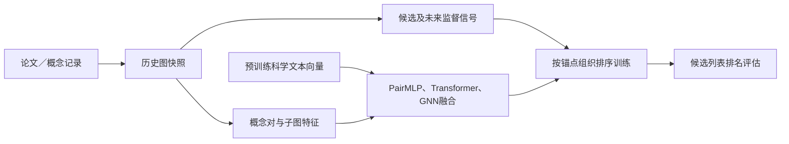

# 基于时序图的科学关系表示与排序学习


**围绕科学知识发现开展的构图、特征表示、神经排序、训练和时序评估研究。** 项目把推荐注意力与局部子图学习迁移到科学论文／概念关系，逐步实现成对结构特征、子图Transformer和GNN的融合打分模型。

[English](README.md) · [简体中文](README.zh-CN.md)

## 核心思想

把科学关系建模为候选排序问题：用历史图结构与科学文本表示学习关系分数。研究从论文引用检索推进到科学概念时序排序，并扩展到FoS数据。每条任务分别保留图、标签、候选集合和评估口径。详见[任务定义与构图](docs/graph_construction.md)。

## 研究流程



时序v15实现21维概念对特征、768维语义输入、局部结构张量和合并子图；FoS版本再增加14维拓扑特征。参见[特征字典](docs/features.md)与[模型说明](docs/models.md)。

## 快速开始

需要Python 3.11+和[uv](https://docs.astral.sh/uv/)。在本仓库根目录执行：

```bash
uv sync --locked --extra train
uv run --locked --extra train python -m tests.test_research_contracts
uv run --locked --extra train python -m examples.synthetic_pipeline
uv run --locked --extra train python -m scripts.check_repository
```

CPU示例调用保留的构图／特征函数与v15修复版本，实际完成前向、反向、参数更新和排名指标计算。图与768维输入向量均为合成数据；无需下载模型权重、访问远程数据或连接训练服务器。它验证代码链路，不作为科研效果分数。参见[实际输出](examples/outputs/synthetic_pipeline.json)及[验证记录](docs/results.md)。

## 模型与学习目标

保留了Phoenix风格论文打分、PENCIL风格局部子图编码、基于图距离变化的成对排序，以及后续三分支融合和分级相关性排序。既有修复版本进一步处理节点身份、图索引和基于预测排名的NDCG权重。这些内容体现模型、数据及训练流程的实际适配；预训练编码器与上游模型思想保留来源。详见[模型机制](docs/models.md)。

## 构图与特征

代码包括累积共现图、首次共现区间图、PPR命名的传播信号及FoS快照，不把这些变体当作相同的数据定义。特征覆盖共同邻居、Adamic–Adar、度数／聚类系数、邻域重叠、启发式gravity特征和科学文本向量。字典标明准确列序，以及重复列和近似量。参见[构图](docs/graph_construction.md)和[特征字典](docs/features.md)。

## 训练与评估

原脚本保留按锚点采样候选、AdamW、余弦调度、checkpoint、early stopping及多历史窗组织。评估包含分级NDCG、二元Precision／Recall／MRR，以及独立的引用检索基线。[训练评估协议](docs/training_evaluation.md)说明标签、分母、采样和划分；[运行说明](docs/reproducibility.md)提供先查看计划、再显式执行的路径适配入口。

## 实验与证据

本地服务器快照保留了2005→2012至2021→2024共五个时间窗的预计算元数据和候选索引。历史README分数按“原记录、核验程度”保留，不补写成稳定预测收益。本轮数值检查和CPU参数更新与历史科研结果分开报告。详见[实验记录与证据](docs/results.md)。

## 目录结构

```text
research/temporal/       历史构图、v5／v15训练与评估
  fixes/                已有v15修复脚本
research/citation/      引用数据、编码、Phoenix／PENCIL适配、检索评估
research/fos/           FoS构图、拓扑特征与训练
examples/               CPU合成图→特征→训练→指标示例
tests/                 小型数值回归检查
scripts/               路径适配与仓库检查
docs/                  构图、特征、模型、协议和实验证据
provenance/            哈希、脱敏历史文档与Git记录
```

## 来源与公开安排

27个研究Python文件逐字节保留，新增内容是文档、依赖、示例、数值检查和路径适配入口。大型数据、checkpoint、连接凭据及服务器自动控制脚本不进入展示包；历史README中连接信息的移除也记入清单。

PENCIL和X/Phoenix的上游版本见[第三方说明](THIRD_PARTY_NOTICES.md)。本人／协作者贡献归属及本项目分发许可证仍需维护者确认；当前只有本地审阅仓库，没有公开远程。参见[来源说明](docs/provenance.md)与[整理变更](CHANGELOG.md)。
