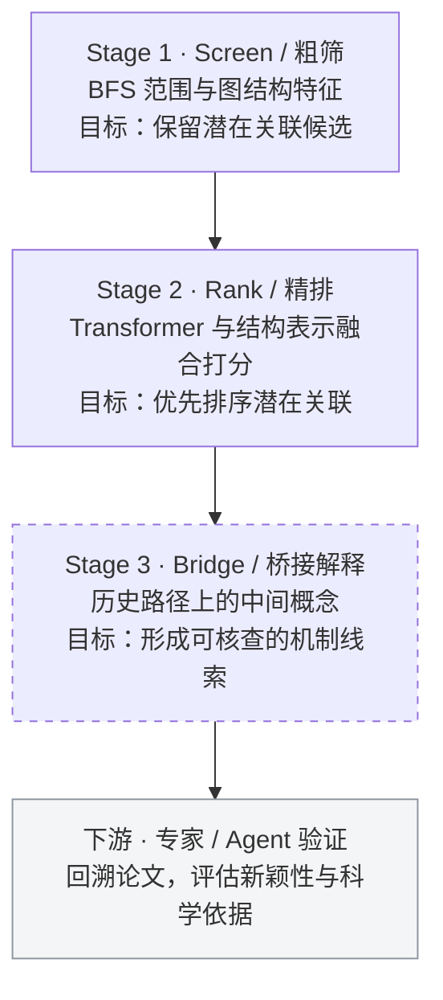

# Catalyst：从科学知识网络中寻找尚未建立的联系

**Literature-Based Discovery · Temporal Knowledge Graphs · Scientific Hypothesis Generation**

[English](README.md) · **简体中文**

Catalyst 探索基于时序科学概念网络的文献知识发现（Literature-Based Discovery, LBD）。项目旨在利用历史图结构识别尚未直接关联的概念对，通过候选排序与桥接解释，为后续文献核查和假设验证提供线索。

**项目状态：研究原型，当前暂停。** 已保留图构建、结构特征、神经排序、训练评估和历史路径处理代码；完整发现流程尚未验证。

## 1. 研究动机：科学知识中的低垂果实

### 1.1 鱼油与雷诺综合征：尚未被发现的公共知识

Swanson 在[1986年的研究](https://pubmed.ncbi.nlm.nih.gov/3797213/)中连接了两组相对独立的医学文献：鱼油研究报告其对血液黏度、血小板聚集和血管反应性的影响；雷诺综合征研究则讨论这些因素与末梢循环异常的关系。两组证据共同指向一个待检验假设：**鱼油是否可能缓解雷诺综合征？**


*Swanson（1986）的文献推理示意，非本项目实验结果。*

这一案例说明，科学发现的机会也存在于已公开知识之间的连接缺口。传统检索依赖预先提出的问题，LBD 则尝试从间接关联中主动生成研究线索。

### 1.2 雪球地球：跨学科知识整合

雪球地球为跨学科知识整合提供了另一例证：低纬度冰川沉积与盖帽碳酸盐岩构成地质证据，冰—反照率反馈解释全球冻结的可能性，风化减弱与火山 CO₂ 持续积累则提供脱离冰冻的机制。[Kirschvink（1992）](https://authors.library.caltech.edu/records/vaysf-cca32)将这些问题联系起来；[Hoffman（2009）](https://doi.org/10.1111/j.1365-2451.2009.00716.x)回顾了此前地质学与气候动力学之间的信息隔阂。

这类案例体现了项目的出发点：**一个学科尚未解决的问题，可能需要连接另一个学科中已有的证据或方法。**

### 1.3 从文献检索转向主动发现

项目旨在从文献网络中识别潜在关联，输出可回溯原始论文的候选概念对及桥接线索，再交由研究者或 AI 科学家系统评估其科学意义。

## 2. 核心设计：时序结构与科学关联预测

### 2.1 结构与语义信息的分工

概念名称与分类往往反映既有学科边界。跨学科关联可能具有较低的文本相似度，却通过共同邻域或间接路径相连。因此，项目以**关系结构及其演化**为主要研究对象，将 SciBERT 语义表示作为部分模型的辅助输入。结构与语义各自的预测贡献仍需通过统一任务下的消融实验检验。

### 2.2 时序科学概念网络

以 OpenAlex 论文、发表年份和概念标签构建时序共现图：概念为节点，符合条件的同篇共现为无向边；论文引用关系用于早期研究分支。令历史时点的可观测网络为 $G_t=(V,E_t)$，原始目标是对尚无直接边、但存在间接路径的概念对估计：

$$
P\big((u,v)\in E_{t+\Delta t}\mid G_{\leq t}\big),\qquad (u,v)\notin E_t
$$

重点考察共同邻居、局部子图、枢纽节点与邻域变化能否提供关联形成前的结构信号。

### 2.3 总体框架：粗筛、精排与桥接解释

系统按三个阶段设计，下游验证由人类专家或 Co-Scientist 式 LLM Agent 承担：



| 阶段 | 设计目标 | 当前实现 |
|---|---|---|
| Screen | 以高召回为目标缩小候选空间 | 已有距离范围、邻域与结构特征筛选，版本间协议不同 |
| Rank | 以高精度为目标细排候选 | 已有 Transformer、PairMLP、GNN 融合与排序训练 |
| Bridge | 为候选关系提供桥接概念 | 已有路径恢复与路径优先子图构建；独立桥接输出尚未完成 |
| 下游验证 | 判断关联是否具有科学价值 | 接口设想，由专家或 Agent 继续核查 |

高召回与高精度是阶段分工的设计目标。现有代码尚未形成经过统一评测的三阶段流水线。

## 3. 特征设计与研究思路

### 3.1 多尺度关系表示

| 特征 | 用途 |
|---|---|
| BFS 距离 | 描述概念间的拓扑距离与候选范围 |
| 双向 PPR 类传播量 | 描述相对位置与网络可达性 |
| Ego-graph | 编码局部邻域结构 |
| 共同邻居及其度分布 | 描述间接连接数量与桥接节点类型 |
| Adamic–Adar | 降低高连接度共同邻居的贡献 |
| 聚类系数 | 描述邻域内部连接程度 |
| SciBERT | 编码概念文本；已定位脚本使用概念名称 |
| 社区归属、连续时序邻域变化 | 设计方向，尚未形成统一验证的实现 |

各特征分布在不同历史版本中。后期 v15 使用 21 维显式结构特征，并结合局部子图与语义输入，详见[特征字典](docs/features.md)。

### 3.2 抑制泛化 hub 的影响

广泛连接的概念可能产生大量缺乏具体研究意义的短路径。项目从三个层面处理这一问题：

- **路径代价**：使用 $c(u,v)=\log((\deg(u)+\deg(v))/2+1)$，提高经过高连接度节点的路径成本。
- **共同邻居降权**：使用 Adamic–Adar，降低高连接度中间节点对关联分数的贡献。
- **低度邻居特征**：对度数低于非零节点度数中位数的共同邻居，单独计算数量与 Adamic–Adar，补充更具体的桥接证据。

以上设计已有[代码实现](research/temporal/precompute_v15.py)，效果增益尚待对照实验验证。

### 3.3 桥接概念预测

桥接阶段关注两个问题：**哪些概念可能建立联系，以及哪些中间概念能够解释这一联系。** 设计中，将历史共现图上连接 $A$、$B$ 的最短路径内部节点作为候选桥接概念；加权图中使用给定代价下的最短路径。它们提供待核查的机制线索，科学机制的成立仍需原文证据支持。

预期输出形式示例：

```text
候选概念对：(Phosphide, Lightning)
候选桥接概念：[early Earth, phosphorus reduction, prebiotic chemistry]
解释方向：在早期地球地球化学与前生命化学语境下，
          核查闪电驱动的磷还原与磷化物形成之间的联系。
```

该例展示桥接解释的输出形式，非已保存的模型预测或最短路径。相关科学联系已有[Hess 等（2021）](https://www.nature.com/articles/s41467-021-21849-2)报道；“首次共现”需相对于具体历史截点另行核验。

历史 [`eval_3hop.py`](history/workspace/eval_3hop.py) 已实现有限跳数内的最短路径恢复，并在子图采样中优先保留路径节点；现有 [`show_bridges.py`](history/server_snapshot/show_bridges.py) 展示的是排序概念对及距离标签。将路径中间节点组织为独立桥接输出，是尚待补齐的环节。

## 4. 代码实现与方法演化

### 4.1 从论文引用到概念关系

研究路线由论文引用检索与推荐模型适配，逐步转向时序概念共现图、距离变化监督和局部子图融合：

| 代码 | 内容 |
|---|---|
| [`research/citation/`](research/citation/) | 引用网络、早期推荐与链接模型适配 |
| [`build_temporal_data.py`](research/temporal/build_temporal_data.py) | 时序概念图与距离变化任务 |
| [`precompute_v15.py`](research/temporal/precompute_v15.py) | 候选构建、结构特征和子图预计算 |
| [`train_temporal_v15.py`](research/temporal/train_temporal_v15.py) | 融合模型、训练与评估 |
| [`fixes/`](research/temporal/fixes/) | 保留的后续修复版本 |

### 4.2 神经模型的实现

后期 v15 在 PyTorch 中融合三个表示分支，输出候选排序分数：

| 分支 | 输入与作用 |
|---|---|
| PairMLP | 21 维显式图特征，编码概念对结构关系 |
| PENCIL 风格 Transformer | 局部子图与预计算语义表示，编码邻域及候选上下文 |
| SubgraphGNN | 两端点及合并子图，编码候选周围的图连接 |

该实现体现了多尺度表示与任务适配的探索。既有方法和第三方代码的归属见[来源说明](docs/provenance.md)与[第三方说明](THIRD_PARTY_NOTICES.md)。

### 4.3 训练与历史实验

历史实验覆盖 2005—2024 年的部分时间窗口，尝试了分类、成对排序、BPR、距离变化排序及 NDCG 加权损失。现有记录尚未支持稳定的科学发现效果。

不同版本的监督目标需分别解释：后期 v15 学习未来加权距离的相关性等级，与原始“首次新连接”目标存在差异。模型细节、候选协议与历史记录分别见[模型说明](docs/models.md)、[训练评估协议](docs/training_evaluation.md)和[实验结果](docs/results.md)。

## 5. 项目状态与主要局限

### 5.1 图稀疏性与训练信号不足

限定学科、概念层级与历史窗口后，有效连接及未来首次跨领域连接的正样本较少，候选空间较大。多种损失与排序策略未获得稳定表现，继续增加模型复杂度难以解决训练信号不足的问题。

### 5.2 概念标签噪声与身份一致性

概念标签质量是暂停项目的主要原因。概念歧义、同义词拆分和论文标签误配可能造成“文献中已有联系、图上却无连接”的错误，直接影响首次连接标签。人工排查曾遇到疑似 `Lightning`（闪电／设备接口）混淆，具体记录仍需回溯概念 ID 与原始论文确认。OpenAlex 已[弃用 Concepts 并转向 Topics](https://help.openalex.org/data/concepts/)；概念一致性仍需单独核验。

### 5.3 实现偏差与评估协议

后续修复处理了候选索引、节点对齐、端点保留、padding 与排序计算问题。部分版本仍将已有直接边纳入候选，并使用未来可达性筛选，尚未统一到严格的历史首次新连接协议。

### 5.4 研究优先级与暂停决定

下一步首先需要修复概念体系、数据与任务定义。考虑到清洗和重训成本，项目暂时搁置，保留代码及实验记录供后续研究使用。

## 6. 后续研究方向

重启时优先评估生物医学文献与 MEDLINE/MeSH 等术语资源，改善概念映射，并固定以下协议：

1. 冻结历史概念集合、节点身份与已有连接。
2. 仅从历史无直接边的概念对构建候选，特征限定使用历史信息。
3. 以未来文献中的首次直接联系构造标签，分别评估粗筛与精排。
4. 输出桥接概念及原文证据，由专家或 Agent 评估其新颖性与科学意义。

## 7. 仓库结构与运行说明

| 路径 | 内容 |
|---|---|
| [`research/citation/`](research/citation/) | 论文引用任务与早期模型 |
| [`research/temporal/`](research/temporal/) | 时序图、特征、排序模型与训练 |
| [`research/temporal/fixes/`](research/temporal/fixes/) | 后续修复版本 |
| [`research/fos/`](research/fos/) | 相关图学习扩展实验 |
| [`history/`](history/) | 历史源码与版本索引 |
| [`docs/`](docs/) | 方法、数据协议、结果与运行文档 |
| [`examples/`](examples/) · [`tests/`](tests/) | 合成数据示例与数值检查 |

Python 3.11+，使用 [uv](https://docs.astral.sh/uv/) 在仓库根目录执行：

```bash
uv sync --locked --extra train
uv run --locked --extra train python -B -m examples.synthetic_pipeline
uv run --locked --extra train python -B -m scripts.check_repository
```

合成示例检查构图、特征、模型前后向与排序指标的执行路径。真实数据复现另需原始论文、概念索引、图矩阵、语义向量及相应运行环境；大规模数据与检查点未完整分发。详见[运行与复现说明](docs/reproducibility.md)。

## 参考资料

1. Swanson, D. R. (1986). [Fish Oil, Raynaud's Syndrome, and Undiscovered Public Knowledge](https://pubmed.ncbi.nlm.nih.gov/3797213/). *Perspectives in Biology and Medicine*.
2. Hoffman, P. F., et al. (1998). [A Neoproterozoic Snowball Earth](https://pubmed.ncbi.nlm.nih.gov/9721097/). *Science*.
3. Hoffman, P. F., & Schrag, D. P. (2000). [Snowball Earth](https://www.scientificamerican.com/article/snowball-earth/). *Scientific American*.
4. Hoffman, P. F. (2009). [Pan-glacial—a third state in the climate system](https://doi.org/10.1111/j.1365-2451.2009.00716.x). *Geology Today*.
5. [OpenAlex — Concepts (deprecated)](https://help.openalex.org/data/concepts/).
6. Kirschvink, J. L. (1992). [Late Proterozoic Low-Latitude Global Glaciation: the Snowball Earth](https://authors.library.caltech.edu/records/vaysf-cca32). In *The Proterozoic Biosphere: A Multidisciplinary Study*.
7. Hess, B. L., Piazolo, S., & Harvey, J. (2021). [Lightning strikes as a major facilitator of prebiotic phosphorus reduction on early Earth](https://www.nature.com/articles/s41467-021-21849-2). *Nature Communications*.
