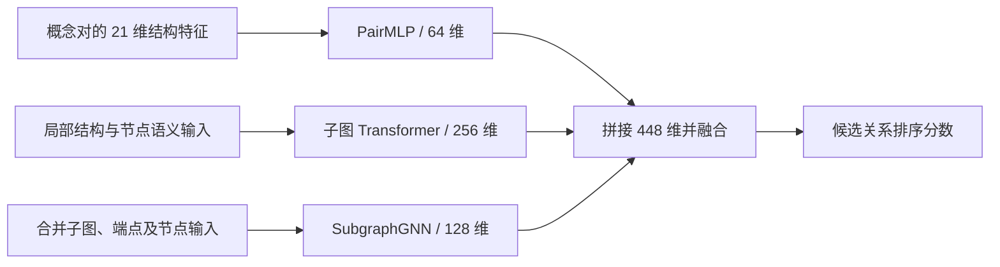

# Catalyst：从时序图中学习潜在科学关联


**以科学概念网络的结构变化为线索，探索哪些尚未直接关联的概念可能在后续研究中建立联系。** 项目围绕文献知识发现（Literature-Based Discovery, LBD），研究时序共现图、hub 影响、结构特征、子图表示与候选排序，并尝试把预测结果进一步组织为可供文献核查的科学关联候选。

**状态：研究原型，持续整理中。** 已保留多版构图、预计算、神经模型和训练评估代码；任务定义、数据协议与部分实现仍需统一。本文分别说明研究目标、已有代码路线和当前问题。Catalyst 暂作展示名称。

[English](README.md) · [简体中文](README.zh-CN.md)

## 🔬 1. 这个项目想解决什么问题

两组科学概念可能分别拥有丰富的文献，却尚未在同一项研究中被联系起来。LBD 的一个切入点是：利用已有知识网络中的间接联系，寻找值得进一步阅读和验证的概念组合。例如，历史图中存在 `A—B—C`，但没有 `A—C`；如果后来的论文同时研究 A 和 C，网络中便出现新的直接关系。

本项目关心的是这种**潜在关系显式化之前的结构信号**：共同邻域如何重叠，连接是否主要依赖泛化 hub，局部子图是否呈现接近趋势，以及这些信息能否帮助对候选关系排序。文本相似度描述“概念在表述上是否接近”，图结构描述“概念与哪些对象相连、处于怎样的位置”。二者提供不同输入，哪一种有效、能否互补，需要在相同任务上比较。

这里的“拓扑坍缩”是对间接路径变成直接连接的直观称呼。文献共现只是可观测的代理信号；一条新共现边并不能自动证明科学发现或解释其形成机制。项目希望先产生有依据的关联候选，再由原文、专家或后续研究工具判断其科学意义。

## 🎯 2. 研究目标与现有训练目标

**希望对齐的发现任务**是在历史时刻固定候选，只考察尚无直接边的概念对，预测后续窗口是否出现新边。令 `G_t=(V,E_t)` 为截至 t 的累积共现图，目标可写为：

```text
历史候选： (u,v) ∉ E_t1
未来标签： y(u,v) = 1，当 (u,v) ∈ E_t2；否则为 0
```

这里的“首次”只相对于采集到的文献历史成立。它还要求历史图、节点身份和时间边界一致，候选筛选不能读取未来结果。

项目实际经历过几种不同的任务化尝试：

| 路线 | 代码中的学习目标 | 与最终目标的关系 |
|---|---|---|
| 论文引用／间接引用检索 | 给定论文与历史引用，检索目标论文或二跳引用对象 | 早期将推荐／链接模型迁移到科学文献的实验 |
| 概念距离收敛 | 从历史图构造概念对，学习 `d_t1(u,v) − d_t2(u,v)` 的排序 | 用“关系在未来接近多少”提供监督，不要求最终直接成边 |
| v15 分级相关性排序 | 将未来**加权距离**划为 0–4 级，学习候选列表排名 | 后期主要实现；仍不等价于严格的首次新边标签 |

例如，路径从四跳变为两跳属于收敛，但没有产生直接边。反过来，加权距离低于某个阈值也不能直接解释为“一跳”。因此本文把**首次关联预测作为研究目标**，把距离变化与分级排序作为已有探索路线；它们的指标不混用。[任务及构图细节](docs/graph_construction.md)。

## 🕸️ 3. 图如何构造，怎样处理 hub

原始数据脚本读取 OpenAlex 文献的年份、概念 ID、置信分数及层级；主要本地输入涉及地质与气候文献。通过概念 ID 对齐节点，在同篇文献内为符合条件的概念对建立无向关系。不同版本改变过层级与分数阈值，不能只凭相同文件名认定图定义相同。

| 图版本 | 保留的含义 | 使用时的区别 |
|---|---|---|
| 累积共现快照 | 截至某个年份已经观察到的边 | 用于表达历史知识状态 |
| 首次共现区间图 | 当前截点区间内首次出现的边 | 表达新增关系，不能直接替代累积历史图 |
| 加权路径图 | 为现有边赋予路径代价，再计算最短路 | 改变接近程度的度量，不等于改变是否共现的事实 |

**hub 的影响是一个实际设计重点。** 如果大量概念都经过少数高连接节点相连，短路径可能只反映泛化概念，而不是具体的关联证据。当前可直接追溯的 v15 `build_weighted_adj` 使用：

```text
c(u,v) = log((degree(u) + degree(v)) / 2 + 1)
```

随后以 Dijkstra 计算路径代价。这样的度数惩罚使经过高连接节点的路径更昂贵；特征层另有 Adamic–Adar，以及只统计低度共同邻居的特征。它们是不同的结构处理手段，尚不能据此断言已有效区分所有“泛化 hub”和“有价值的桥接 hub”。

PMI 加权的对应版本仍在核对归档。本 README 按已定位函数给出上述权重定义，不把度数惩罚与基于共现概率的 PMI 混为同一算法。代码中名为 PPR 的传播量也保留具体实现说明，避免仅按名称推定其数学性质。[权重、图版本和传播定义](docs/graph_construction.md) · [本轮版本核查](docs/design_status.md)。

## 🧩 4. 特征构造：结构是主线，SciBERT 是其中一部分

项目不是只把概念名编码成向量再计算相似度。已有实现同时处理概念对的显式拓扑量、单个概念的局部结构，以及两个概念合并后的子图。

| 表示层 | 具体输入 | 希望捕捉的信息 |
|---|---|---|
| 概念对特征 | 双向传播分数、共同邻居、Jaccard、Adamic–Adar、度数、聚类系数等 | 两个概念的接近程度与邻域关系 |
| 补充结构特征 | 低度共同邻居、低度 Adamic–Adar、邻域凝聚、二阶重叠、连通性／路径强度代理量 | 关系是否由具体局部结构支撑 |
| 概念局部结构 | 最多 64 个位置，129 维结构张量，包括位置、局部邻接和传播分数 | 单个概念周围的结构模式 |
| 概念对合并子图 | 最多 256 个节点、边及两个端点的局部索引 | 连接两端的局部图环境 |
| 语义输入 | 部分模型使用预训练 SciBERT 产生的 768 维概念名称向量 | 为图中节点提供文本描述信息 |

v15 的概念对输入是 **15+6=21 维**；FoS 扩展再加入 k-core、Fiedler、邻居度数统计等 14 维，形成单独的 35 维配置。部分特征存在重复列，`resistance_distance` 等名称对应的是启发式代理量，而不是严格的有效电阻。准确列序与表达式保留在[特征字典](docs/features.md)。

SciBERT 在这些模型中作为预先计算的节点输入使用，并非整个研究方法，也不是本项目重新训练的基础编码器。结构特征的单独作用、语义的增量收益和两者的互补性，需要后续消融来回答；当前不采用“语义已被证明无效”或“系统完全零语义依赖”的结论。

## 🧠 5. 模型怎样把这些信息组合起来

后期 v15 按三条分支组织表示，再融合为候选分数：



PairMLP 学习显式概念对特征的组合；PENCIL 风格编码器结合 Transformer 注意力与局部图消息更新，学习邻域结构的表示；SubgraphGNN 在合并图上进行三层残差消息传递，并读取两个端点和全图平均表示。融合层将三者组合后输出标量分数。该分数用于排名，未校准为“科学发现概率”。[原始模型](research/temporal/train_temporal_v15.py) · [保留的修复版](research/temporal/fixes/train_temporal_v15_fix.py)。

这条路线来自对已有推荐与图学习方法的理解和任务适配：早期 Phoenix 风格模型把用户／历史／候选的组织方式换成科学论文及其引用；随后将局部子图表示用于概念时序排序，调整节点输入、候选组织和学习目标。PENCIL、Phoenix 和预训练编码器的来源分别保留在[第三方说明](THIRD_PARTY_NOTICES.md)。

候选筛选与神经排序构成“先缩小搜索范围，再学习区分候选”的设计分工，但尚无统一实验验证一个完整两阶段系统的召回收益。桥接解释方面，历史脚本会展示概念名称、候选分数和距离变化；专门预测中间桥接概念、结合原文形成机制解释的输出，仍不是当前模型中已经验证的能力。

## 📐 6. 训练与评估怎样组织

训练以一个锚点概念及其候选列表为单位。v15 默认采样 100 个候选，少于该数量时有放回采样；使用 AdamW、余弦学习率调度、checkpoint 和按验证 NDCG 的 early stopping。默认配置为 batch size 8、学习率 `3e-4`、最多 30 个 epoch、patience 5；这是脚本配置，不是最佳参数结论。

早期距离收敛模型使用成对排序；v15 改为分级相关性排序。已有修复版用当前预测排名计算交换候选的 NDCG 权重，并以加权 RankNet softplus 优化候选间次序。原实现的权重依赖输入位置，因此原版与修复版分别保留，不能把后者的局部测试解释为已经重训得到的性能提升。

五个历史窗口为 `2005→2012`、`2012→2015`、`2015→2017`、`2017→2021`、`2021→2024`。v15 的 rolling 入口合并前四窗训练，用第五窗选择 checkpoint；因此第五窗在该流程中属于验证集，不能又当作完全独立测试集。

| 指标 | 当前代码中的含义 |
|---|---|
| NDCG@K | 衡量当前候选列表中 0–4 级相关性的排序 |
| Precision／Recall@K | 以相关性至少为 4 的候选为正例；Recall 分母是该采样列表内正例数量 |
| MRR | 列表中首个正例的倒数排名 |
| 引用检索 target-hit | 另一条任务中，特定间接引用目标是否出现在检索结果中 |

这些数字不能互换成全图新边召回。原时序实现还对没有正例的列表采用不同的指标汇总规则；具体分母、候选采样和评估入口见[训练评估协议](docs/training_evaluation.md)。

## 🧪 7. 当前进展，以及为什么还没有收束

已有的工作包括：多版科学图构建，距离与结构特征预计算，神经模型与排序训练实现，以及五个时间窗的保存索引。归档中 `2021→2024` 窗保留 4,734 个锚点、1,831,632 条候选索引记录；它们证明有实际的数据准备工作，同时原索引存在一致性问题，不能直接视为已核验的完整训练集。

整理版还提供可运行的小型 CPU 示例：调用保留的构图与特征函数，运行融合模型的前向／反向及三次参数更新，并计算排名指标。70 节点图和 768 维向量都是合成输入；这验证程序路径，没有构成真实数据上的效果实验。[实际记录](docs/results.md)。

| 需要解决的问题 | 已核对的具体情况 | 对研究结论的影响 |
|---|---|---|
| 目标与候选还未完全一致 | v15 候选含历史一跳邻居，且构造时使用未来可达性筛选 | 不能直接用其分数证明历史未知新边预测有效 |
| 距离语义需要统一 | 加权路径长度、普通跳数和首次共现区间图在版本间不同；“first-hop-free”函数实际减去常数 1 | 需要重新固定图、标签和正例定义 |
| 索引、节点与损失存在实现问题 | 已有修复版处理分组索引、端点保留、padding、节点特征对齐及排名权重 | 修复代码的局部通过不代表全量结果已重新成立 |
| 效果与解释尚缺完整验证 | 缺少可复算的统一真实数据对照、语义／结构消融和桥接输出评价 | 不把历史零散分数写成稳定收益或机制发现 |

项目目前的实质是：围绕潜在科学关联探索了多种图表示和学习方式，也暴露出“研究目标怎样落实为无泄漏训练任务”的问题。下一轮应先固定候选、图和标签，再比较结构基线与模型分支，而不是继续叠加模型复杂度。[版本与参考稿核对](docs/design_status.md)。

## ▶️ 8. 运行、数据要求与代码入口

需要 Python 3.11+ 和 [uv](https://docs.astral.sh/uv/)。从仓库根目录执行：

```bash
uv sync --locked --extra train
uv run --locked --extra train python -B -m tests.test_research_contracts
uv run --locked --extra train python -B -m examples.synthetic_pipeline
uv run --locked --extra train python -B -m scripts.check_repository
```

以上为离线机制检查，安装依赖可能访问软件包索引。完整研究运行另需论文记录、概念 ID 顺序、图／传播矩阵、语义输入（若模型使用）和相应 checkpoint。仓库未附全量语料与权重。路径适配器默认仅显示执行计划：

```bash
uv run --locked --extra train python -B -m scripts.run_research
uv run --locked --extra train python -B -m scripts.run_research --task precompute-v15-fix --data-root data/pencil_data -- --fold 0
```

准备好独立实验目录后，再按[运行说明](docs/reproducibility.md)显式添加 `--execute`。原始脚本可能覆盖指定数据目录的缓存和 checkpoint；修复版预计算与训练需成套使用。

```text
research/temporal/       共现图、时序模型、预计算与评估的代表性版本
  fixes/                原先已保留的 v15 修复实现
research/citation/      论文引用任务、编码与推荐／子图模型适配
history/                去重后的历史版本、来源与原提交索引
research/fos/           FoS 数据适配与额外拓扑特征
docs/                  图定义、特征列、模型、协议、结果及设计状态
examples/ / tests/      合成链路与小型数值检查
provenance/            原始文件哈希与脱敏历史记录
```

## 🧭 9. 后续收束方向与来源

下一步优先对齐一个明确任务：在固定历史文献集合上构造候选，严格排除已有直接边，让未来数据只用于标签。冻结概念身份、图版本、候选 ID、采样和时间窗后，再比较共同邻居／Adamic–Adar 等结构基线、显式特征模型、子图模型与语义融合；另外保留独立测试窗。PMI 分支的版本归档继续核对，桥接路径／原文证据输出作为独立目标评价。

主研究目录保留 27 个研究 Python 文件及其来源哈希；[历史版本目录](history/README.zh-CN.md)另补充 151 份源码快照，映射 597 个保留来源条目并记录四个原始 Git 提交。它们共同展示问题定义、模型改造、数据处理和实验探索，主入口保持原有组织。原始代码保持不变；当前仓库位于 GitHub 私有工作区，供继续完善文档与版本。上游方法、个人修改与实验结果分别保留出处。[来源说明](docs/provenance.md) · [第三方说明](THIRD_PARTY_NOTICES.md)。项目整体分发许可证尚未选定，不沿用参考稿中未经确认的 MIT 声明。
